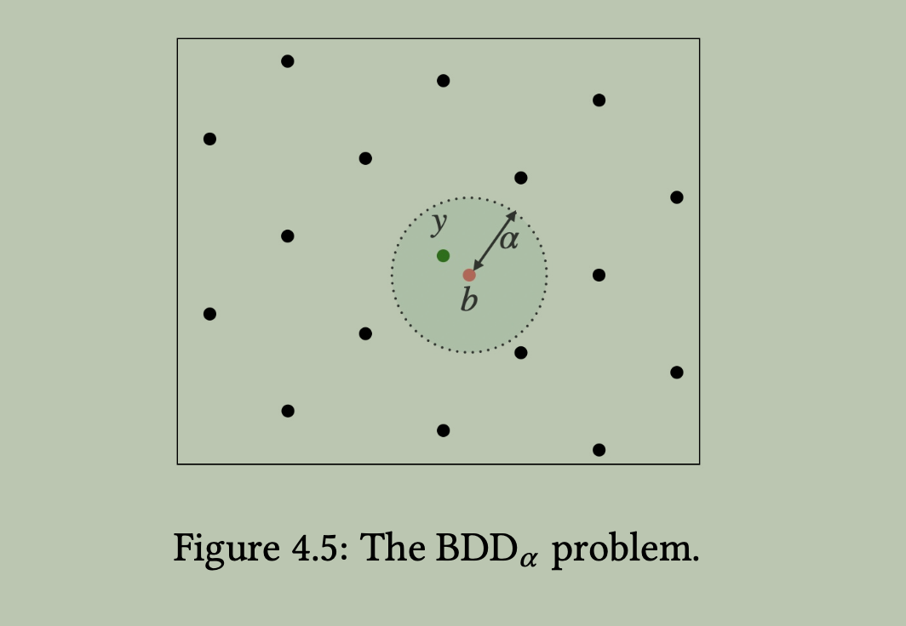

Table of Contents

- [Ch02 - Early Results](#ch02---early-results)
- [Ch03 - Modern Foundations](#ch03---modern-foundations)
  - [3.1 - SIS Problem](#31---sis-problem)
    - [3.1.1 - Definition](#311---definition)
    - [3.2 - Observations](#32---observations)
    - [3.3 - Normal Form](#33---normal-form)
    - [3.4 - Hardness](#34---hardness)
  - [3.2 - LWE](#32---lwe)
    - [3.2.1 - Definition](#321---definition)
    - [3.2.2 - Observations](#322---observations)
    - [3.2.3 - Normal Form](#323---normal-form)
    - [3.2.4 - Hardness of ssLWE](#324---hardness-of-sslwe)
- [\\end{pmatrix}](#endpmatrix)
    - [3.2.5 - Cryptographic Applications](#325---cryptographic-applications)
  - [3.3 - Ring-SIS](#33---ring-sis)
  - [3.4 - Ring-LWE](#34---ring-lwe)

 

# Ch02 - Early Results

1. Why do we need worse-case to average-case reductions in lattice-based cryptography?

    *Lattice hard problems are believed to be difficult to solve in the worst case. But not every instance of these problems is hard, and some instances may be easy to solve, for example when we use orthogonal basis vectors. In cryptography, we need to ensure **almost all** instances of the problem are hard, or average-case hard, to guarantee the security of cryptographic schemes. So we rely on worst-case to average-case reductions to construct cryptographic primitives whose security is based on the hardness of worst-case lattice problems.*

 

2. Why hyperplane ?

    It translate the closeness between a inner product and an integer into a geometric condition, specifically the distance from a point to a hyperplane defined by the lattice vectors.

    Given a secret vector $s$, define the hyperplane associated with an integer $j$ by :
    $$
        H_{s, j} = \{ x \in \mathbb{R}^n : \langle s, x \rangle = j \}
    $$
    where $x$ are vectors whose projection on $s$ is fixed value $j / \| s \|$, so the collect of $x$ forms a hyperplane which is **perpendicular** to $s$. Different $j$ corresponds to parallel hyperplanes at different distances along the direction of $s$. *These hyperplane has been embeded important geometric information, distance and direction.*

    If we want to know how close between $\langle s, x \rangle$ and an integer $j$, we can measure the distance from $x$ to the hyperplane $H_{s, j}$:
    $$
        \text{dist}(y, H_{s, j}) = \frac{|\langle s, y \rangle - j|}{\| s \|}
    $$

 

# Ch03 - Modern Foundations

## 3.1 - SIS Problem

### 3.1.1 - Definition 

Given a matrix $A \in \mathbb{Z}_q^{n \times m}$ and a positive integer $\beta$, the Short Integer Solution (SIS) problem asks to find a non-zero integer vector $z \in \mathbb{Z}^m$ such that:
$$
    A z \equiv 0 \pmod{q} \quad \text{and} \quad \| z \| \le \beta.
$$

 

### 3.2 - Observations

1. If no constraint on $\| z \| \le \beta$, then it is easy to find a solution via Gauss elimination. Furthermore, in order to ensure the solution of $z$ is non-trivial, we have to constrain parameter $\beta \lt q$, otherwise many trivial solutions exists, for example $z = [q, 0, ..., 0] \in \mathbb{Z}^m$.

2. We see that solving the SIS problem is solving a constrained linear system over the integers. So, more constrains implies more difficulty for finding a solution, and more unkowns (or variables) generally makes the problem easier, as it provides more degrees of freedom to satisfy the constraints. Therefore, we have 

    * larger $n$ increases the number of constraints, making the problem harder.
    * larger $m$ increases the number of variables, making the problem easier.
    * larger bound $\beta$ allows for larger solution space to search, making the problem easier.

3. $m > n \log_2 q$ and $\sqrt{m} \le \beta$ guarantees the existence of solutions  to the SIS problem. 

    Consider a map represented by matrix $A$, its input is $x \in \{0, 1\}^m$, and output is $y = A x \pmod{q} \in \mathbb{Z}_q^n$. There are $2^m$ possible elements in input domain, and $q^n$ possible elements in the output domain. If $2^m > q^n$, then by the pigeonhole principle, there must exist distinct inputs $x_1, x_2 \in \{0, 1\}^m$ such that $A x_1 \equiv A x_2 \pmod{q}$. Consequently, $z = x_1 - x_2 \in \{-1, 0, 1\}^m$ is a non-zero solution to the SIS problem if it is within the bound $\| z \| \le \beta$.

    Obviously, the solution norm is bounded by $\| z \| \le \sqrt{m}$. Thus, if we further set the bound parameter $\sqrt{m} \le \beta$, then existence of a non-trivial solution $z$ to the SIS problem is always guaranteed.

 

### 3.3 - Normal Form 

Actually, SIS instances can often be compressed without changing the underlying problem significantly. Given a matrix $A \in \mathbb{Z}_q^{n \times m}$, one can compress the size of instance $A$ by $n$ columns through a technique from linear algebra called **Hermite normal form (HNF)**.

Specifically, we can split matrix $A$ into two parts $A = [A_1 \mid A_2]$, *assume the left square matrix $A_1 \in \mathbb{Z}_q^{n \times n}$ is invertible*, that is to say, the first $n$ columns are linearly independent. Then, we can transform $A$ into its Hermite normal form:
$$
    A_1^{-1} \cdot A \equiv [I_n \mid \overline{A} = A_1^{-1} A_2] \pmod{q},
$$
where $I_n$ is the $n \times n$ identity matrix. If $z \in \mathbb{Z}^m$ is a solution to the SIS problem for the original matrix $A$, then it is also a solution for its HNF matrix $[I_n \mid \overline{A}]$. Vice versa, any solution for the HNF matrix is also a solution for the original matrix $A$.

 Here is the explanation ... 

For the forward direction 
$$
A z = 0 \implies A_1^{-1} (A z) = 0
$$
always trivially holds.

For the backward direction
$$
A_1^{-1} A z = 0 \implies A z = 0
$$
also holds since $A_1$ is invertible ensures that all columns of $A_1$ are linearly independent, that is $A z = 0$.

 

### 3.4 - Hardness

For now, we see that pure SIS problem is not a kind of classical lattice problems, for example SVP, CVP, or SIVP. But we can relate its hardness to these problems through **reductions**. We will immediately show how to construct a SIVP instance from a given SIS instance.

----

First of all, let us recall the definition of the SIVP problem. Given a lattice $\Lambda = \mathcal{L}(B) \subset \mathbb{R}^n$ with rank $n$ and a parameter $\gamma \ge 1$, the $\gamma$-SIVP problem asks to find $n$ linearly independent lattice vectors $v_1, \dots, v_n \in \Lambda$ such that
$$
\| v_i \| \le \gamma \cdot \lambda_n(\Lambda) \quad \text{for all } i = 1, \dots, n,
$$
where $\lambda_n(\Lambda)$ denotes the $n$-th successive minimum of the lattice $\Lambda$, i.e., the smallest radius $r$ such that $\Lambda$ contains $n$ linearly independent vectors of norm at most $r$.

 

Then, we will focus on constructing a SIVP instance from a given SIS instance with a lattice $\Lambda$ with basis $B$, and show how the hardness of SIS can be related to the hardness of SIVP.

**Step 0: Initialization**

1. a lattice $\Lambda = \mathcal{L}(B)$ with rank $n$.
2. initialization with basis $S^{(0)} = B$.
3. a SIS oracle instance

 

**Step 1: Sampling the SIS matrix**

Given a fixed set of lattice vectors $S^{(0)}$, we aim to sample a SIS matrix $A$ that corresponds to lattice vectors $V$ generated from this initial basis. This will allow us to later query the SIS oracle to obtain solutions $z$ that can be used to construct SIVP vectors.

- (a) Sample an integer vector $u_i$ by the initial set $S^{(0)}$ understand specific distribution :
    $$
        S^{(0)} \rightarrow u_i \in \mathbb{Z}^n
    $$
    and repeat $m$ times to obtain a integer matrix $U \in \mathbb{Z}^{n \times m}$.
- (b) Modulo reduction to obtain the SIS matrix $A$:
    $$
        A \equiv U \mod q \in \mathbb{Z}_q^{n \times m}
    $$
- (c) Generate temporary lattice vectors corresponding to the SIS matrix $A$:
    $$
        V \equiv B \cdot U \in \mathbb{R}^{n \times m}
    $$

Define the initial length of $S^{(0)}$ as $L^{(0)} = \max_{v \in S^{(0)}} \| v \|$, under some specific distribution we can ensure that the length of the temporary lattice vectors $V$ is bounded as :
$$
L_V^{(0)} \le L^{(0)} p(n)
$$
where $p(n)$ is some polynomial function of the lattice rank $n$. We do not plan to dive into the sampling technique in detail here.

 

**Step 2: Constructing an SIVP vector** 

Given a SIS instance oracle, we can query it with the sampled SIS matrix $A$ to obtain a non-trivial solution $z \in \mathbb{Z}^m$ such that
$$
A z = 0 \pmod{q} \tag{3.1}
$$

Then, we can construct a new lattice vector with the SIS solution vector $z$ and temporary sampled lattice matrix $V$ as follows:
$$
v = \frac{V \cdot z}{q} = \frac{B \cdot A \cdot z}{q} = B \cdot \frac{A \cdot z}{q} = B \cdot c 
$$
where $c = \frac{A \cdot z}{q} \in \mathbb{Z}^n$ is an integer vector as equation (3.1) already ensures that $A \cdot z$ is divisible by $q$. Thus, vector $v$ is a lattice vector in $\Lambda$. We need to check that if the newly generated vector $v$ satisfies the two SIVP conditions: 

- independent from the previously generated vectors like $v$

- short enough $\| v \| \le \gamma \cdot \lambda_n(\Lambda)$ 

    > [!Warning]
    Notice that $\lambda_n(\Lambda)$ is an intrinsic property of the lattice that represents the length of the longest vector among the $n$ linearly independent shortest vectors in the lattice. We do not know its exact value in general, it only provides a benchmark for analysis, we won't actually compare $\| v \|$ with $\lambda_n(\Lambda)$ in practice.

We will focus on the second condition which is more tricky to satisfy in practice, as it involves ensuring that the newly generated lattice vector is sufficiently short relative to the lattice's intrinsic geometry.

----

We can try to bound the length of the new lattice vector $v$ as follows. By triangle inequality, we have
$$ 
\| V z \| \le \sum_{i=1}^m |z_i| \cdot \| v_i \|,
$$
, then we have 
$$
\sum_{i = 1}^m | z_i | \cdot \| v_i \| \le \| z \|_1 \cdot L_V^{(0)} \le \| z \|_1 \cdot L^{(0)} p(n).
$$
By Cauchy-Schwarz inequality $| \langle u, v \rangle | \le \| u \|_2 \cdot \| v \|_2$, we have
$$
\| z \|_1 = \langle z, \mathbf{1} \rangle \le \| z \|_2 \cdot \| \mathbf{1} \|_2 = \| z \|_2 \cdot \sqrt{m},
$$
which implies
$$
\| V z \| \le \| z \|_1 \cdot L_V^{(0)} \le \sqrt{m} \cdot \| z \|_2 \cdot L_V^{(0)} \le \sqrt{m} \cdot \| z \|_2 \cdot L^{(0)} p(n).
$$

Therefore, the norm of the reduced lattice vector $v$ is bounded as :
$$
\| v \| = \left\| \frac{V z}{q} \right\| = \frac{\| V z \|}{q} \le \frac{\sqrt{m} \cdot \| z \|_2 \cdot L^{(0)} p(n)}{q} \le \frac{\sqrt{m} \cdot \beta}{q} \cdot L^{(0)} p(n).
$$
So if the parameter $q$ is sufficiently large compared to $\sqrt{m} \cdot \beta \cdot p(n)$, the norm of the reduced lattice vector $v$ can be made much smaller compared with initial bound $L^{(0)}$ of the set $S^{(0)}$.

----

Therefore, for each newly generated lattice vector $v$, once we confirmed that the independent condition is satisfied, then we need to check that if its length drops as we desired :
$$
\| v \| \le \delta \cdot L^{(0)}
$$
where $\delta = \frac{\sqrt{m} \cdot \beta}{q} \cdot p(n)$. 
- If yes, then repeat step 1-2 generating more lattice vectors $v$ to fill the newly set $S^{(1)}$ with sufficiently short and independent lattice vectors.
- If no, discard the generated lattice vector $v$ and repeat the steps 1-2 to generate a new candidate $v$ (still with fixed set $S^{(0)}$) until the desired length drop condition is satisfied or the maximum number of attempts $t_m$ is reached.

After some trials, if the newly set $S^{(1)}$ is full, then repeat the entire process with the new set $S^{(1)}$, until terminate at round $k$ : 
$$
S^{(0)} \to S^{(1)} \to S^{(2)} \to \dots \to S^{(k)}
$$
. At round $k$, we are trying to fill the newly set $S^{(k + 1)}$ with $S^{(k)}$, but maximum number of attempts $t_m$ is reached, then the process terminates and we take $S^{(k)}$ as the final set of sufficiently short and independent lattice vectors. And we deem that 
$$
L^{(k)} \le \gamma \cdot \lambda_n(\Lambda) 
$$
this newly set satisfies the second SIVP condition with high probability.

 

## 3.2 - LWE

### 3.2.1 - Definition

**LWE distribution**

For a secret vector $s \in \mathbb{Z}_q^n$ and an error distribution $\chi$ over $\mathbb{Z}_q$, the LWE distribution $A_{s, \chi}$ is defined as the distribution over pairs $(a, b) \in \mathbb{Z}_q^n \times \mathbb{Z}_q$ where $a$ is chosen uniformly at random from $\mathbb{Z}_q^n$ and $b = \langle a, s \rangle + e \mod q$ with $e$ sampled from $\chi$.

 

**Search-LWE problem**

Given access to $m$ independent samples $(a_i, b_i)$ from the LWE distribution $A_{s, \chi}$ for some secret $s \in \mathbb{Z}_q^n$ and error distribution $\chi$, the search-LWE problem asks to find the secret vector $s$.    

 

**Decision-LWE problem**

Given access to $m$ independent samples $(a_i, b_i)$ from either the LWE distribution $A_{s, \chi}$ for some secret $s \in \mathbb{Z}_q^n$ and error distribution $\chi$, or from the uniform distribution over $\mathbb{Z}_q^n \times \mathbb{Z}_q$, the decision-LWE problem asks to distinguish which distribution the samples come from.

 

### 3.2.2 - Observations

1. Without error vector $e$, the solution of LWE problem can be easily solved by Gauss elimination, as it reduces to a system of linear equations over $\mathbb{Z}_q$.

2. Given sampled integer matrix $A \in \mathbb{Z}_q^{n \times m}$, define lattice $\mathcal{L}(A)$ over $\mathbb{Z}^m$ (not in $\mathbb{R}^m$) by :
    $$
        \mathcal{L}(A) = \{ A^t s + q \mathbb{Z}^m : s \in \mathbb{Z}_q^n \}.
    $$
    Its orthogonal lattice is given by 
    $$
        \mathcal{L}^\perp(A) = \{ z \in \mathbb{Z}^m : A z = 0 \pmod q \}.
    $$
    And dual lattice of $\mathcal{L}(A)^\perp$ is given by
    $$
        \mathcal{L}^\perp(A)^* = \{ \frac{A^t s}{q} + k : s \in \mathbb{Z}_q^n, k \in \mathbb{Z}^m \}. 
    $$

    By definition, for any $x \in \mathcal{L}(A)$, $z \in \mathcal{L}^\perp(A)$, and $y \in \mathcal{L}^{\perp}(A)^*$, we have
    $$
        \langle z, x \rangle \equiv 0 \pmod q, \quad \langle y, z \rangle \in \mathbb{Z}.
    $$

3. For any given sample $(a_i, b_i) \in A_{s, \chi}$, we have
    $$
        \langle (-s, 1), (a_i, b_i) \rangle = - \langle s, a_i \rangle + b_i \equiv e_i \pmod q. 
    $$
    Without error $e_i$, we can be sure that 
    $$
        \langle (-s, 1), (a_i, b_i) \rangle \equiv 0 \pmod q.
    $$
    which implies that the samples $x = (a_i, b_i)$ lie in some hyperplane in the direction of $(-s, 1)$.

 

### 3.2.3 - Normal Form

Similar with what we did on HNF of SIS instance, we split LWE instance matrix $A \in \mathbb{Z}_q^{n \times m}$ into two parts as
$$
    A = [A_1 \mid A_2],
$$
where $A_1 \in \mathbb{Z}_q^{n \times n}$ is invertible over $\mathbb{Z}_q$ and $A_2 \in \mathbb{Z}_q^{n \times (m-n)}$. Accordingly, we split error vector $e \in \mathbb{Z}_q^m$ into two parts as
$$
    e = [e_1 \mid e_2],
$$
where $e_1 \in \mathbb{Z}_q^n$ and $e_2 \in \mathbb{Z}_q^{m-n}$. Then the LWE instance can be rewritten as
$$
    A_1^t s + e_1 \equiv b_1 \pmod q \in \mathbb{Z}_q^n, \quad A_2^t s + e_2 \equiv b_2 \pmod q \in \mathbb{Z}_q^{m-n},
$$
where $b = [b_1 \mid b_2]$ is the corresponding split of the LWE sample vector $b \in \mathbb{Z}_q^m$. 

 

An LWE instance $(A, b) \in \mathbb{Z}_q^{n \times m} \times \mathbb{Z}_q^m$ can be compressed into $(\overline{A}, \overline{b}) \in \mathbb{Z}_q^{n \times (m-n)} \times \mathbb{Z}_q^{m-n}$, where
$$
    \overline{A} = -A_1^{-1} A_2 \pmod q, \quad \overline{b} = (\overline{A})^t b_1 + b_2 = (\overline{A})^t e_1 + e_2 \pmod q.
$$
The new LWE matrix $\overline{A}$ satisfies $A_1 \overline{A} + A_2 = 0 \pmod q$, ensuring that the compressed LWE instance $(\overline{A}, \overline{b})$ is equivalent to the original instance $(A, b)$ modulo $q$.

 

### 3.2.4 - Hardness of ssLWE

$$
\text{worst-case approximate Lattice Problems} \le \text{average-case ssLWE} \le \text{BDD} \le \text{worst-case exact SVP}
$$

The hardness chain tells us :

1. the worst-case approximate lattice problems are believed to be computationally hard, no efficient algorithm is known to solve them in general.
2. the worst-case exact lattice problem is at least as $\gamma$ times hard as the worst-case approximate lattice problem, where $\gamma$ is the approximation factor.
3. the hardness of most LWE variant problems, including ssLWE, are based on worst-case approximate lattice problems. 
3. ssLWE problem can also be reduced to BDD problem, then further to worst-case exact SVP problem (not approximate SVP).

 

**Definition : ssLWE Problem**

Upon LWE problem, if we restrict the domain from which the secret vector $s$ and error vector $e$ are drawn to be small, we obtain the short secret LWE (ssLWE) problem. More specifically, both $s$ and $e$ are drawn from a bounded range $[-B, B]^n$ for some small bound $B$.
$$
s, e \in [ -B, B ]^n
$$
where $B \le \sqrt{\frac{q}{4(2n + 1)}}$, and $q > 6(2n + 1)$ ensures the uniquenss of the solution to the ssLWE instance.

 

**Definition : LWE Lattice**

$$
\mathcal{L}(A) = \{ A x \pmod q : x \in \mathbb{Z}^n \}
$$
where $A \in \mathbb{Z}_q^{m \times n}$ is the matrix from the LWE instance, whose columns are linearly independent over $\mathbb{Z}_q$.

 

**Definition : BDD Problem**

Given an integer lattice $\mathcal{L}(A) \subseteq \mathbb{Z}_q^m$, vector $b \in \mathbb{Z}_q^m$ and distance bound $\alpha > 0$, the Bounded Distance Decoding (BDD) problem asks to find the unique lattice vector $y \in \mathcal{L}(A)$ such that
$$
    \| y - b \| < \alpha. 
$$

 

**Reduction : ssLWE to BDD**

For the ssLWE problem, if we could find the closest lattice vector $y \in \mathcal{L}(A)$ from target vector $b$, then the secret $s$ can be easily solved in the linear system defined by the LWE instance : 
$$
s = A^{-1} (y - b) \pmod q.
$$
So, the ssLWE problem can be reduced to the BDD problem.

**Reduction : BDD to SVP**

We known that :
$$
\| b - y \|=  \| e \| \le \sqrt{2} B
$$

Let $\alpha = \sqrt{2} B$, By Kannan's embedding technic, if 
$$
\alpha < \frac{\lambda_1({L}(A))}{\sqrt{2}}
$$
then the BDD problem can be reduced to SVP. That is, if we find the  solution of a SVP instance, then the BDD problem can be solved as well. Next, we will construct the SVP instance whose solution corresponds to the solution of the BDD problem.

 Kannan's Embedding Reduction from BDD to SVP 

Suppose $y \in \mathcal{L}(A)$ is the only closest lattice vector from the target vector $b$ in the BDD problem. 

**Step 1:**

Define a new basis matrix :
$$
A' = \begin{pmatrix}
A & -b \\
0 & \alpha
\end{pmatrix}
$$
obviously the last column $[-b, \alpha]^T$ is linearly independent from other columns of $A'$, so a new lattice is expanded $\mathcal{L}(A')$ with dimension $n + 1$. Any lattice vector can be expressed as :
$$
\begin{pmatrix}
A x - cb \\
c \alpha
\end{pmatrix}
= 
\begin{pmatrix}
v - c b \\
c \alpha
\end{pmatrix}
$$
where $v \in \mathcal{L}(A)$ and $c \in \mathbb{Z}$. We will show that $(v, c) = (y, 1)$ is the unique solution of the SVP instance on $\mathcal{L}(A')$. 

**Step 2:**

Let $\widetilde{v} = [y - b, \alpha]^T \in \mathcal{L}(A')$, since $\| e \| \le \alpha$, then we have 
$$ 
\| \widetilde{v} \| = \sqrt{\| y - b \|^2 + \alpha^2} = \sqrt{\| e \|^2 + \alpha^2} \le \sqrt{2} \alpha
$$
the only condition for Kannan's embedding technic is $\alpha < \frac{\lambda_1({L}(A))}{\sqrt{2}}$. In this case, we can conclude that :
$$
\lambda_1(\mathcal{L}(A')) \le \| \widetilde{v} \| \le \sqrt{2} \alpha <  \lambda_1(\mathcal{L}(A)) 
$$
So, if we can prove that 
$$
\lambda_1(\mathcal{L}(A')) = \| \widetilde{v} \|
$$
then with the help of the solution of SVP instance on $\mathcal{L}(A')$, we can obtain its scalar vector$[x, c]$, further the solution of BDD problem $y = A x$ is solved as well. 

**Step 3:**

Suppose $v' = \lambda_1(\mathcal{L}(A')) = [v - c b, c \alpha]^T$, let's consider four cases :

1. if $c = 0$, then  
    $$
    \| v' \| = \| v \| \ge \lambda_1(\mathcal{L}(A)) \ge \| \widetilde{v} \|
    $$
    contradiction happens.
2. if $|c| \ge 2$, then
    $$
    \| v' \| = \sqrt{\| v - c b \|^2 + (c \alpha)^2} \ge |c| \alpha \ge 2 \alpha > \sqrt{2} \alpha \ge \| \widetilde{v} \|
    $$
    contradiction happens as well.
3. if $c = -1$ and $-v$ is not the closest lattice vector $y$ ($-v \ne y$) then
    $$
        \| v' \| = \sqrt{\| v + b \|^2 + \alpha^2} = \sqrt{\| (-v) - b \|^2 + \alpha^2} \ge \alpha \ge \| \widetilde{v} \|
    $$
    contradiction happens.
4. if $c = 1$ and $v$ is not the closest lattice vector $y$ ($v \ne y$) then
    $$
    \| v' \| = \sqrt{\| v - b \|^2 + \alpha^2} \gt \sqrt{\| y - b \|^2 + \alpha^2} = \| \widetilde{v} \|
    $$
    contradiction happens.
    
The only remaining case is when $c = 1$ and $v = y$ (or $c = -1$ and $-v = y$), in which case we have :
$$ 
\| v' \| = \sqrt{\| v - b \|^2 + \alpha^2} = \sqrt{\| y - b \|^2 + \alpha^2} = \| \widetilde{v} \|
$$
or 
$$
\| v' \| = \sqrt{\| -v - b \|^2 + \alpha^2} = \sqrt{\| y - b \|^2 + \alpha^2} = \| \widetilde{v} \|
$$

 

### 3.2.5 - Cryptographic Applications

**Setup**

Generate *pub-key* and *secret-key* as follows :
$$
b = A^T s + e \pmod q
$$
where LWE instance $(A, b) \in \mathbb{Z}_q^{n \times m} \times \mathbb{Z}_q^m$ is the *public-key* which is shared between prover and verifier, $s \in \mathbb{Z}_q^n$ is the *secret-key* which is kept private by the prover, and $e \in \mathbb{Z}_q^m$ is the error vector sampled from the appropriate distribution which is kept secret by the prover.

**Encryption**

To encrypt a bit message $\mu \in \{0, 1\}$, the sender samples a random vector $r \in \mathbb{Z}_2^m$ and computes the ciphertext as
$$
\begin{aligned}
u &= A r \pmod q \\
v &= b^T r + \mu \lfloor q/2 \rfloor \pmod q
\end{aligned}
$$
where $(u, v)$ is the ciphertext corresponding to the bit message $\mu$.

**Decryption**

To decrypt the ciphertext $(u, v)$, the receiver computes
$$
\mu' = v - s^T u = e^T r + \mu \lfloor q/2 \rfloor \pmod q.
$$
If $\mu' \approx 0 \pmod q$, the decrypted bit is $0$, and if $\mu' \approx \lfloor q/2 \rfloor \pmod q$, the decrypted bit is $1$. The correctness relies on the fact that the error term $e^T r$ is small enough to distinguish between the two cases.

> [!Important]
> How to ensure $e^T r$ is small enough for correct decryption? 

 

## 3.3 - Ring-SIS

## 3.4 - Ring-LWE