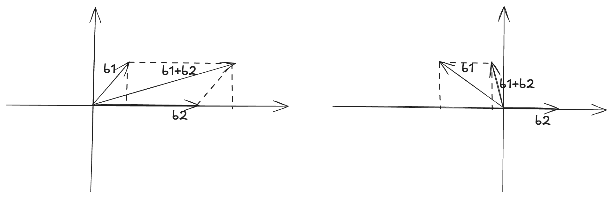
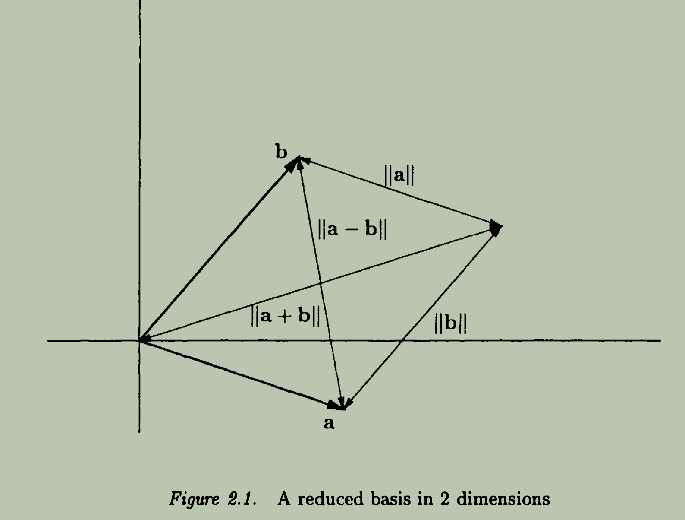
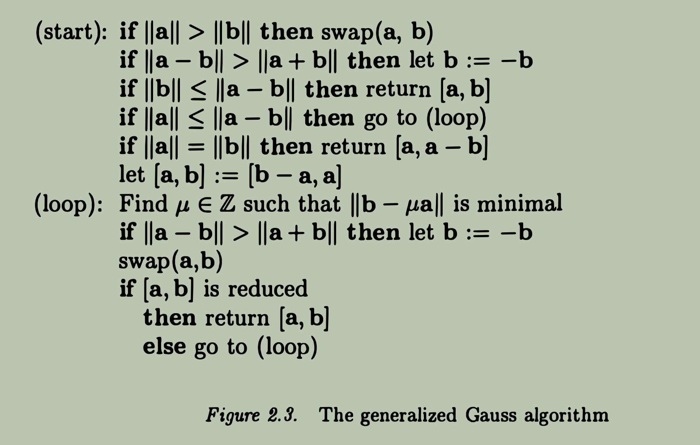
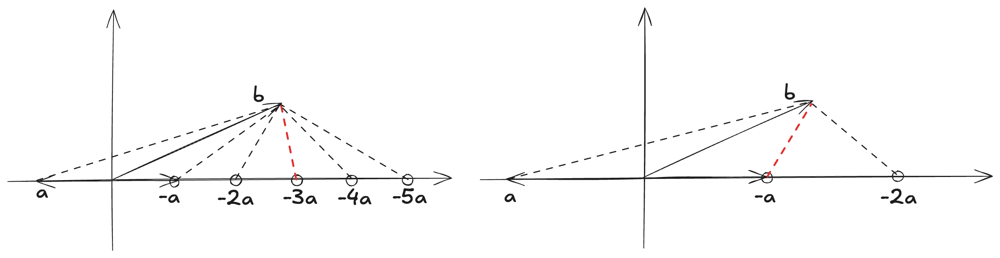
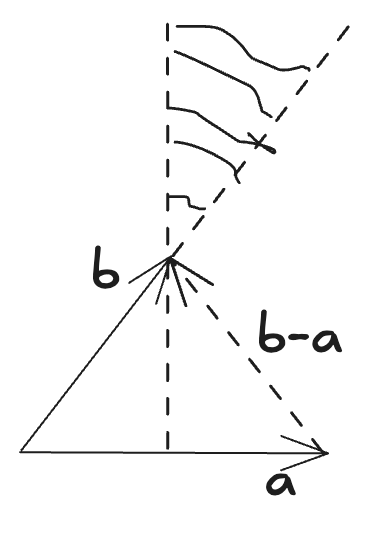

# Solving SVP in Dimension 2

## Reduced Basis

Definition 2.1 - Let $[a, b]$ be a lattice basis. The basis is reduced if 
$$
|\| a \|, \| b \| \le \| a + b \|, \| a - b \|
$$

> [!Note] Intuition Behind
> Consider constructing a triangle with known two edges $a$ and $b$, the third edge is unknown. If $[a, b]$ is reduced, by definition, we can say that $a, b$ are the shortest two edges of the triangle.

----
 

Lemma 2.1 - Consider three vectors on a line, $x, x + y, x + ay$, where $a \in \mathbb{R}$. Then if $\| x \| \le \| x + y \|$ then $\| x + y \| \le \| x + ay \|$, moreover $\| x + y \| \le \| x + ay \|$.

Explanation

Intutively, given $x, x + y$, if $\| x \| \le \| x + y \|$, then we are clear that both $x$ and $y$ are pointing in roughly the same direction, and adding any multiple of $y$ to $x + y$ will only increase the norm.

Similarly, if $\| x \| \le \| y - x \|$, then $y$ and $x$ are pointing in roughly the contradictory direction, furthermore, $\| x \| \le \| y - x \| \le \| ay - x \|$.

 

> [!Important]
> So what is the relationship between reduced basis and the successive minima of the lattice?

Theorem 2.2 - Let $[a, b]$ be a lattice basis, and let $\lambda_1$ and $\lambda_2$ be the successive minima of the lattice. If the basis is reduced, then $\| a \| = \lambda_1$ and $\| b \| = \lambda_2$.

Explanation

From the definition of reduced basis, we know that whether $a$ and $b$ have the same direction or not, we need to ensure that either of $a$ or $b$ is the shortest vector in the lattice. Without loss of generality, we assume $\| a \| \le \| b \|$ :
- if $a, b$ have the same direction, then $\| b \| \le \| a + b \|$.
- if $a, b$ have the opposite direction, then $\| b \| \le \| a - b \|$.
put them together, we need to ensure $\| b \| \le \min \{ \| a + b \|, \| a - b \| \}$. Therefore,  
$$
\| a \| \le \| b \| \le \min \{ \| a + b \|, \| a - b \| \}
$$
In general, we have  
$$
\| a \|, \| b \| \le \| a + b \|, \| a - b \|
$$
namely, basis $[a, b]$ is reduced.

 

## Gauss Algorithm

Definition 2.2 - For a lattice basis $[a, b]$, without loss of generality, we assume $\| a \| \le \| b \|$, if $\| a \| \le \| a - b \| \le \| b \|$, then we call the basis $[a, b]$ a well-ordered basis.

 

**Algorithm**

Explanation

For the line-1 and line-2, we are trying to ensure 
- lattice vector $a$ is the smaller one, i.e., $\| a \| \le \| b \|$ 
- both lattice vectors $a$ and $b$ are in the same direction, i.e., $\| a - b \| \le \| a + b \|$.

----

After then we will consider following cases :

1. For the line-3, it is the simplest case where $\| b \| \le \min \{ \| a + b \|, \| a - b \| \} = \| a -  b \|$, in this case, we must have :
    $$
    |\| a \| \le \| b \| \le \| a - b \| \le \| a + b \|
    $$
    then the basis $[a, b]$ is strictly reduced, and they are in the same direction, return $[a, b]$.

2. For the rest of lines, it is the case of $\| a - b \| \lt \| b \|$, there are two subcases to consider:

   - (2.1) for the line-4, $\| a \| \le \| a - b \| \lt \| b \|$, then basis $[a, b]$ is a typical well-ordered basis, and they are in the same direction.

   - (2.2) for line-5 and line-6, $\| a - b \| \le \| a \| \le \| b \|$, then there are two subcases to consider : 

      - (2.2.1) for the line-5, $\| a - b \| \le \| a \| = \| b \|$, this is a very special case, $\|a \| = \| b \|$ and $\| a - b \| \le \| a \|$ ensure that vectors $a - b$ and $a$ are in the same direction, in this case, $\| a \| = \| b \| \le \| 2a - b \|$. Since $\| (a - b) - a \| = \| b \|$, thus the basis $[a - b, a]$ is reduced, and they are in the same direction, return $[a - b, a]$.

      - (2.2.2) from line-6, $\| a - b \| \le \| a \| < \| b \|$, we do not know the whether $a - b$ and $a$ are in the same direction or not, but $\| a \| \le \| b \|$ and $\| a - b \| \le \| a \|$ ensures that vectors $b - a$ and $a$ are in the same direction, so $\| b - a \| \le \| (b - a) - a \| \le \| a \|$. Therefore, the basis $[b - a, a]$ is well-ordered basis. 

----

The remaining problem is how to find the reduced basis through well-ordered basis in the loop :

1. Since $[a, b]$ is a well-ordered basis, there are other lattice vectors that can be fit between $[\| a \|, \| b \|]$, what we need to do is finding the smallest one. This is achieved by find the integer $\mu$ such that $\| b - \mu a \|$ is minimal, then replace $b$ with $b - \mu a$.

2. Now we can check that if the updated basis $[a, b]$ is reduced, but before checking we need to make sure that $\| a \| \le \| b \|$, if not, swap $a$ and $b$.

3. repeat the above steps until the basis $[a, b]$ is reduced.

 

Next, we will focus on how to find the minimal vector between two well-ordered basis vectors in the Gauss loop.

**Minimal Vector in Gauss Loop**

*Lemma 2.3 - Let $a, b$ be two vectors such that $\| b - a \| < \| b \|$. Then, one can efficiently find an integer $\mu$ such that $\| b - \mu a \|$ is minimal. Moreover, $\mu$ satisfies $1 \le \mu \le \lceil 2\frac{\| b \|}{\| a \|} \rceil$.*

Explanation

Note that, in Gauss algorithm, before entering the loop, we have ensured that the basis $[a, b]$ is well-ordered, i.e., $\| a \| \le \| b \|$ and $\| a \| \le \| a - b \| \le \| b \|$. But, this theorem does only mentioned last-half condition of well-ordered basis, i.e., $\| a - b \| \le \| b \|$. So this is a more general setting than the well-ordered basis condition.

----

For better understanding Gauss algorithm, we will specially consider the l2 norm, and explain why we are able to find the minimal vector between $a$ and $b$ in Gauss loop if $[a, b]$ is well-ordered with geometric intuition. 

Condition $\| a \| \le \| a - b \| < \| b \|$  implies :
- vectors $a, b$ are in the same direction.
- projection scalar of $b$ onto $a$, i.e., $\frac{\langle a, b \rangle}{\| a \|^2} > 1/2$. 
- the minimal distance between $b$ and $a$ is $\| b - \frac{\langle a, b \rangle}{\| a \|^2} a \|$.

Two cases involved in finding the optimal integer $\mu$ are:
1. If $\frac{1}{2} < \frac{\langle a, b \rangle}{\| a \|^2} \le 1$, then $\| b - \mu a \|, u \in \mathbb{N}$ increases as $\mu$ moves away from the minimal value $\frac{\langle a, b \rangle}{\| a \|^2}$. In this case, $\mu = 1$ is the optimal integer choice.
2. If $\frac{\langle a, b \rangle}{\| a \|^2} > 1$, then $\| b - \mu a \|, u \in \mathbb{N}$ increases in the range $[1, \frac{\langle a, b \rangle}{\| a \|^2})$, and decreases in the range $(\frac{\langle a, b \rangle}{\| a \|^2}, \infty)$. In this case, the optimal integer choice must come from either $\lfloor \frac{\langle a, b \rangle}{\| a \|^2} \rfloor$ or $\lceil \frac{\langle a, b \rangle}{\| a \|^2} \rceil$.

----

Additionally, we will simply explain why $\frac{\langle a, b \rangle}{\| a \|^2} > 1/2$ in the contex of well-ordered basis with one diagraph below.

 

**Why Gauss Loop Works**

For now, we have only illustrated how Gauss loop works, and more specially how to find the minimal vector between two well-ordered basis vectors in the Gauss loop. But we have not touched why the loop works? or why we are able to eventually reach a reduced basis through repeated iterations from a well-ordered basis.

----

We know that the first step of Gauss loop is to find the minimal vector between the two basis vectors $a$ and $b$ which are well-ordered, i.e., $b' = b - \mu a$, where $\mu$ is the integer that minimizes $\| b - \mu a \|$. Theoretically, the new vector $b'$ could be :
1. $\| a \| \le \| b' \|$,
2. $\| b' \| \lt \| a \|$. 

For the condition (1), since $\| b' \| = \| b - \mu a \|$ is minimized, so : 
- $\| b - \mu a \| \le \| b - (\mu - 1) a \|$ implies $\| b' \| \le \| b' + a \|$ 
- $\| b - \mu a \| \le \| b - (\mu + 1) a \|$ implies $\| b' \| \le \| b' - a \|$

Thus, if $\| a \| \le \| b' \|$, then basis $[a, b']$ is already reduced. The Gauss loop will terminate for this pair of vectors.

For the condition (2), we know that step two of Gauss loop ensures that $b'$ and $a$ are in the same direction by flipping the sign of the new vector $b'$ if necessary, i.e., $\| b' - a \| \le \| b' + a \|$. Since $\| b' \| \lt \| a \|$, we have $\| b' - a \| \le \| a \|$, furthermore, $\| b' \| \le \| b' - a \| \le \| a \|$. Therefore, basis $[b', a]$ is well-ordered.

Then the Gauss loop will continue with the new well-ordered basis $[b', a]$, repeating the process until a reduced basis is obtained.

 

## Running Time Analysis

By analysing the Gauss loop, we know that given input well-ordered basis $[b, c]$, we can obtain a new well-ordered basis $[a, b]$ unless the basis is already reduced. Note that, in one iteration vector $b$ not changed, only vector $a$ is invented. Then repeating the process more times will eventually lead to a reduced basis. So our concern is : is the number of iterations (time complexity) bounded by a polynomial of the input size $N$ (bits of one vector entry)? The answer is yes, but before our final conclusion, a lemma is needed.

----

Suppose the first input basis vector is $[a_{n - 1}, a_n]$, next input is $[a_{n - 2}, a_{n - 1}]$, ..., till the last input is $[a_1, a_2]$,
and $[a_1, a_2]$ is reduced.

*Lemma 2.4 - For $i \ge 3$, $\| a_i \| \le 1/2 \| a_{i + 1} \|$.*

Explanation

Let $[a, b, c] = [a_{i - 1}, a_i, a_{i + 1}]$, given input well-ordered basis $[b, c]$ output another well-ordered basis $[a, b]$. Then we need to show the input lengths satisfy $\| b \| \le 1/2 \| c \|$.

As we know, $a = \pm(c - \mu b)$ for some integer $\mu$ that minimizes $\| a \|$. We can consider it with following cases :
1. $\mu = 1$
2. $\mu = 2$
3. $2 \le \mu$

We omit the details proof here.

 

----

Given the input basis $[a, b]$ of Gauss algorithm, and $[a_{k}, a_{k + 1}]$ is the first well-ordered basis entering the Gauss loop, after $k$ iterations, we obtain the following inequality : 
$$
2^{k - 2} \le 2^{k - 2} \| a_{3} \| \le \| a_{k + 1} \| \le \| a \| + \| b \|
$$
Since before entering the Gauss loop, we may have swapping, negation, or substrating operations, but :
$$
\| a_{k + 1} \| \le \| a \| + \| b \| 
$$
always holds. It is clear that the number of iterations is bounded :
$$
k \le \log_2 (\| a \| + \| b \|) + 2
$$
If the number of bits of one vector entry is $N$, suppose there are $m$ entries in one vector, then :
$$ 
\| a \| \le \sqrt{m \cdot (2^N \cdot 2^N)} = \sqrt{m} \cdot 2^N
$$
So we have :
$$
k \le (N + 3) + \log_2 \sqrt{m}
$$
As $m$ is fixed, the term $\log_2 \sqrt{m}$ is constant, so $k = O(N)$.

 

# Approximating SVP in Dimension n

 

# Approximating CVP in Dimension n

 
