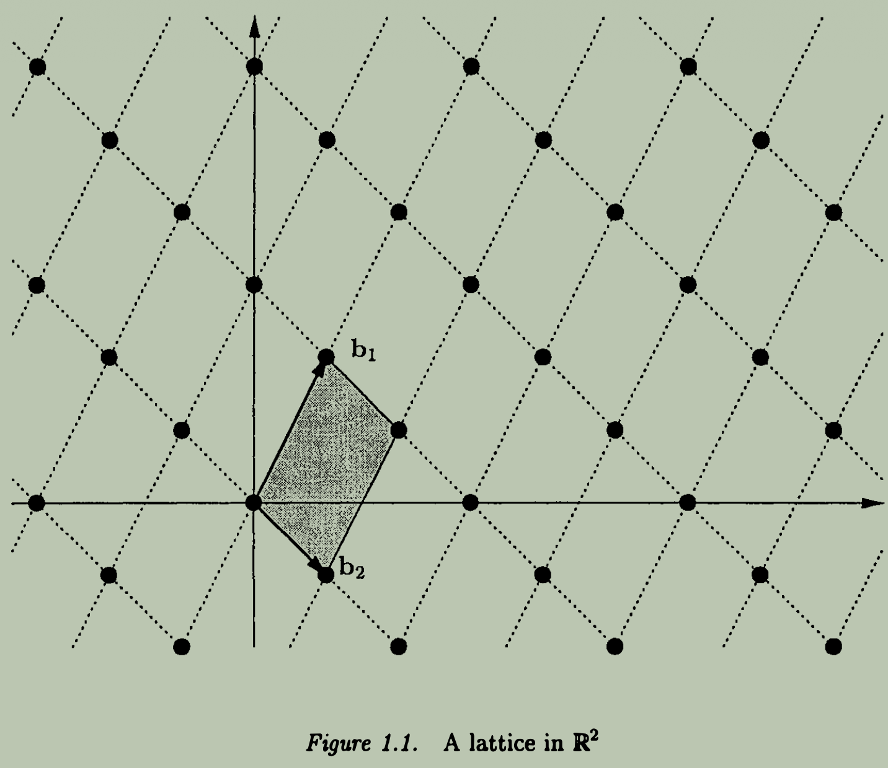
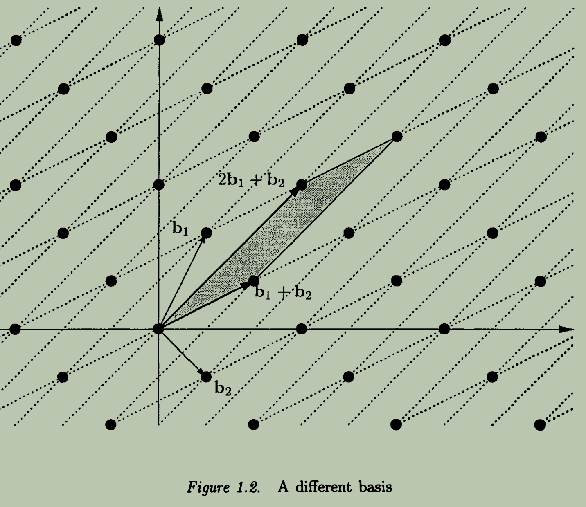
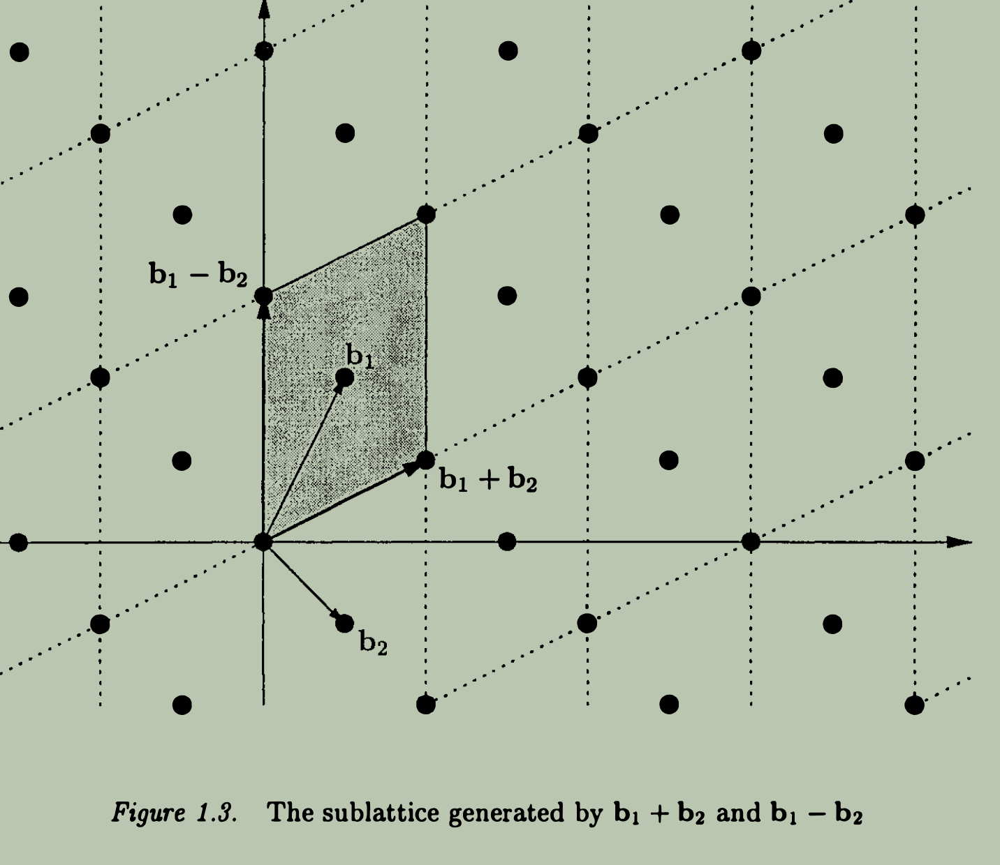
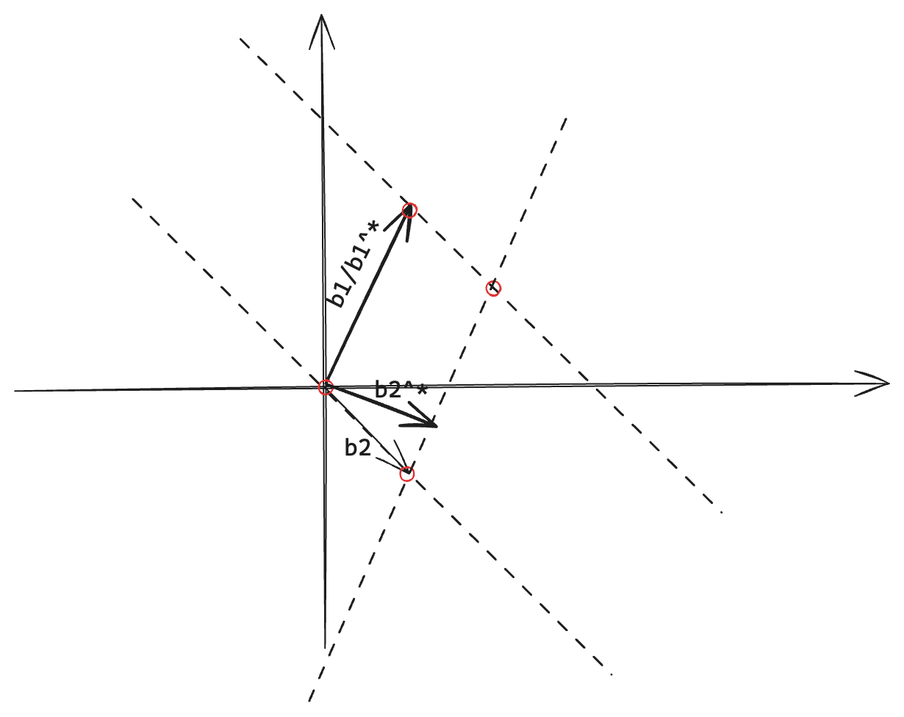
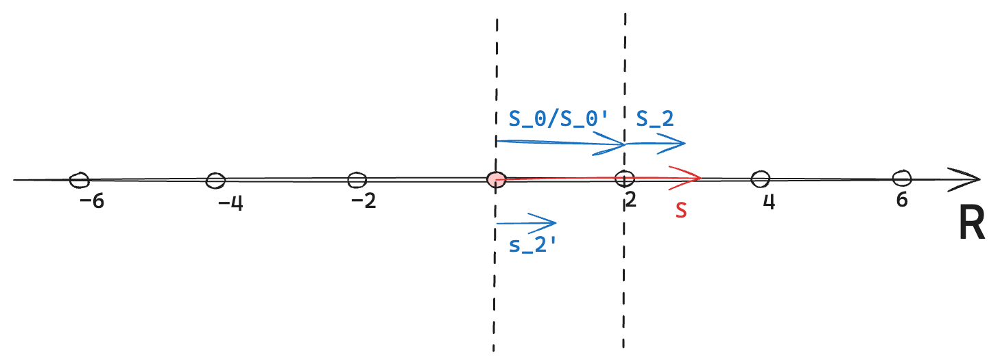
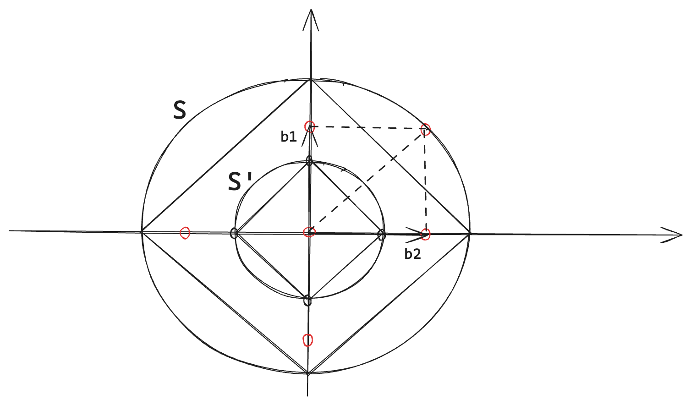
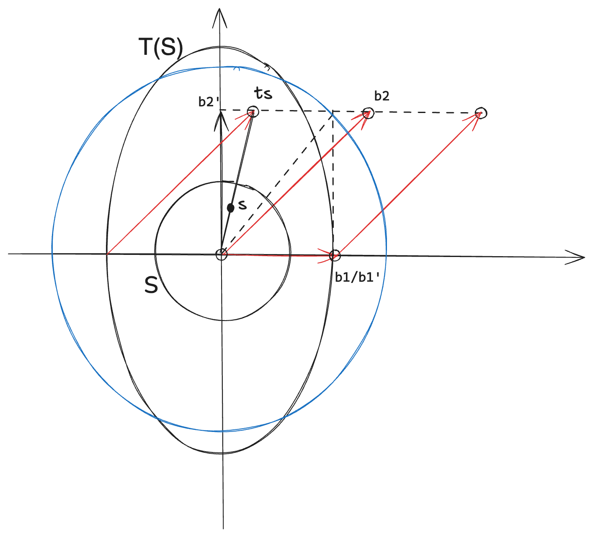
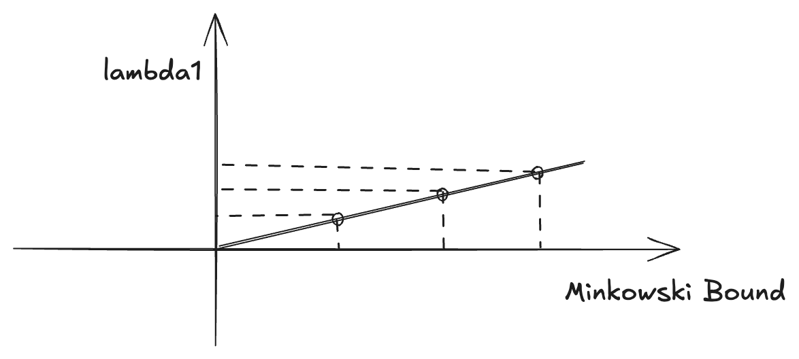
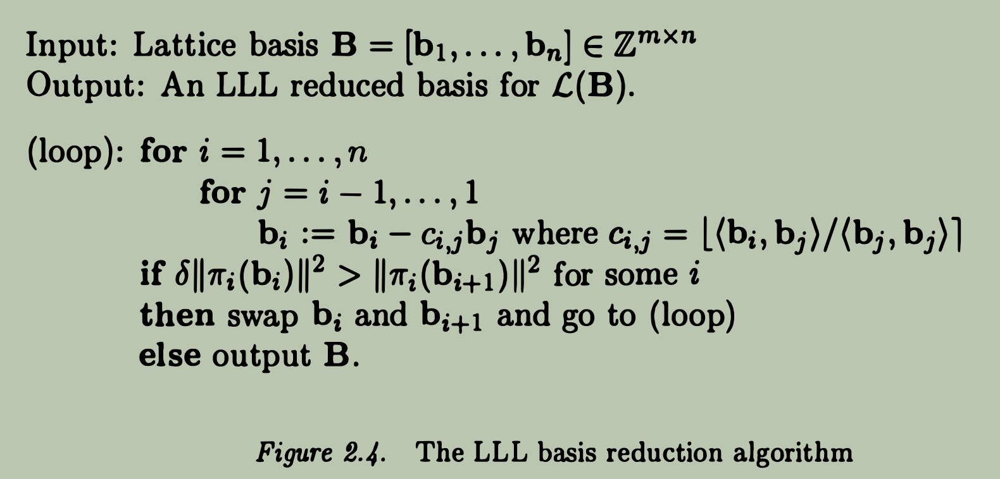
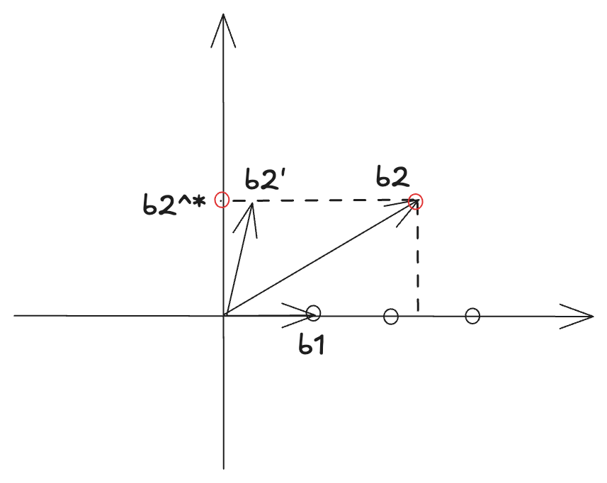

# Complexity of Lattice Problems

Table of Contents

- [Basics](#basics)
  - [Lattice](#lattice)
    - [Determinant](#determinant)
    - [Successive Minima](#successive-minima)
    - [Minkowski's Theorem](#minkowskis-theorem)
  - [Computational Problems](#computational-problems)
    - [Same Lattice Problems](#same-lattice-problems)
- [Solving SVP in Dimension 2](#solving-svp-in-dimension-2)
  - [Reduced Basis](#reduced-basis)
  - [Gauss Algorithm](#gauss-algorithm)
  - [Gauss Running Time Analysis](#gauss-running-time-analysis)
- [Approximating SVP in Dimension n](#approximating-svp-in-dimension-n)
  - [The LLL basis reduction Algorithm](#the-lll-basis-reduction-algorithm)
    - [Basis Reduction](#basis-reduction)
    - [Lovasz Condition Check](#lovasz-condition-check)
  - [LLL Running Time Analysis](#lll-running-time-analysis)
    - [Bound the Number of Iterations](#bound-the-number-of-iterations)
    - [Bound the Time Cost Per Iteration](#bound-the-time-cost-per-iteration)
- [Approximating CVP in Dimension n](#approximating-cvp-in-dimension-n)

 

In complexity theory, we say a problem is hard if it it hard for the worst-case instance; while in cryptography, a problem is deemed hard only if it is hard for the average-case instance (i.e., for all but a negligible fraction of instances).

## Basics

### Lattice

**Definition of a Lattice**

Let $\mathbb{R}^m$ be the $m$-dimensional Euclidean (inner product) space. A lattice in $\mathbb{R}^m$ is the set
$$
\mathcal{L}(b_1, ..., b_n) = \left\{ \sum_{i=1}^{n} z_i b_i \mid z_i \in \mathbb{Z} \right\}
$$
of all integer linear combinations of the basis vectors $b_1, ..., b_n$, where $n \le m$ is the rank of the lattice, and $m$ is the dimension of the lattice.

> [!Note] Domain of Lattice and Vector Space
> Note that the vector (Euclidean) space is defined over field $\mathbb{R}$, but the lattice itself is defined over the integers $\mathbb{Z}$. I think this is a fundamental difference between lattice and general subspace. Because lattice is **discrete**, it is only restricted to "integer span" of the basis vectors, whereas subspace is defined over the entire field $\mathbb{R}$ and can take arbitrary linear combinations of the basis vectors, which makes it **continuous**.

 

**Representation of a Lattice**

There are many different ways to represent a lattice, depending on the choice of basis vectors. For example, in 2-dimensional space $\mathbb{R}^2$, a lattice can have different bases that generate the same set of points.

|               One Basis               |                  Another Basis                  |
| :-----------------------------------: | :---------------------------------------------: |
|  |  |

Where the left image shows a lattice generated by basis,
$$
b_1 = \begin{pmatrix}1 \\ 2\end{pmatrix}, \quad b_2 = \begin{pmatrix}1 \\ -1\end{pmatrix}
$$
and the right image shows a lattice generated by another basis,
$$
b_1' = b_1 + b_2 = \begin{pmatrix}2 \\ 1\end{pmatrix}, \quad b_2' = 2b_1 + b_2 = \begin{pmatrix}3 \\ 3\end{pmatrix}
$$
We see that, the (intersection) points of the two lattices coincide, meaning that both bases generate the same set of lattice points in $\mathbb{R}^2$.

> [!Note] Why do different bases generate the same lattice?
> One question here : is there any relationships between these bases that generate the same lattice? The answer is yes, if they are related by a unimodular transformation, i.e., an integer matrix with determinant $\pm 1$. That is,
>$$
>B' = UB, \quad \text{where } U \in \mathbb{Z}^{n \times n} \text{ and } \det(U) = \pm 1.
>$$

----

 

We have already noticed that a lattice is defined over the integers $\mathbb{Z}$ which is **discrete**, whereas the Euclidean space is defined over the field $\mathbb{R}$ which is **continuous**. Recall that in linear algebra, the $\text{span}(B)$ is independent of the choice of basis $B$, meaning that any basis that generates the same subspace will have the same span. For lattices, different bases can also generate the same lattice.

**Fact 1.1 - Span of Lattice Bases**

If $B$ and $B'$ generate the same lattice, then $\text{span}(B) = \text{span}(B')$.

Proof

To show $\text{span}(B) = \text{span}(B')$, we need to prove two inclusions:

1. $\text{span}(B') \subseteq \text{span}(B)$
2. $\text{span}(B) \subseteq \text{span}(B')$

---

Regarding (1), since $B' = B U$ where $U$ is invertible, basis $B'$ is a linear combination of the columns of $B$, meaning that any linear combination of the columns of $B'$ can also be expressed as a linear combination of the columns of $B$. Therefore, $\text{span}(B') \subseteq \text{span}(B)$.

Regarding (2), since $B = B' U^{-1}$ where $U$ is invertible, basis $B$ is a linear combination of the columns of $B'$, meaning that any linear combination of the columns of $B$ can also be expressed as a linear combination of the columns of $B'$. Therefore, $\text{span}(B) \subseteq \text{span}(B')$.

Completing the proof.

 

Clearly, we see :

1. In this case, lattice $\mathcal{L}(B)$ and vector space $\text{span}(B)$ are closely related, but they are not the same. The lattice consists of discrete points, while the vector space contains all linear combinations of the basis vectors with real coefficients .

2. Any set of $n$ linearly independent vectors from lattice $\mathcal{L}(B)$ forms a basis for vector space $\text{span}(B)$. But this set does not necessarily generate the entire lattice $\mathcal{L}(B)$.

    For example, two vectors from a lattice $\Lambda = \mathcal{L}(b_1, b_2)$,
    $$
    b_1' = b_1 + b_1 = [2, 1]^\top \\
    b_2' = b_1 - b_2 = [0, 3]^\top
    $$
    are independent, they are surely able to form a basis for vector space $\text{span}(b_1, b_2) = \mathcal{span}(\Lambda)$. But they cannot generate the lattice $\Lambda$ since $b_1 = \frac{1}{2} (b_1' + b_2')$, not an integer combination of $b_1'$ and $b_2'$.

> [!Note]
> So what is the characteristic of vectors that can form a lattice basis? How to remove the non-integer linear combinations from consideration?

**Fact 1.2 - Valid Lattice Basis**

Given a lattice $\mathcal{L}(B)$ with basis $B = [b_1, ..., b_n]$, and $n$ linearly independent lattice vectors,
$$
B' = [b_1', ..., b_n'], b_i' \in \mathcal{L}(B)
$$
We define
$$
\mathcal{P}(B') = \left\{ \sum_{i=1}^n x_i b_i' : 0 \leq x_i < 1 \right\}
$$
as the **half-open parallelepiped** generated by the basis $B'$. Note that the coefficients $x_i$ are restricted to the interval $[0, 1)$, which ensures that each point in $\mathcal{P}(B')$ is uniquely represented. Then $B'$ is a lattice basis if and only if $\mathcal{P}(B')$ does not contain any lattice vector (points) other than the zero vector (origin point).

 

> [!Note]
> If $B'$ is not a lattice basis for $\mathcal{L}(B)$, i.e., $\mathcal{L}(B') \ne \mathcal{L}(B)$. Since it is still linearly independent, so it also generates a lattice $\mathcal{L}(B')$ which is different from $\mathcal{L}(B)$. But, what is the relationship between $\mathcal{L}(B)$ and $\mathcal{L}(B')$?

**Fact 1.3 - Sublattice**

Sublattice is an natural concept after **half-open parallelepiped**, if there are lattice points from $\mathcal{L}(B)$ in the half-open parallelepiped, which implies a inclusion relationship :
$$
\mathcal{L}(B') \subseteq \mathcal{L}(B).
$$
If $\mathcal{L}(B') \subsetneq \mathcal{L}(B)$, then we call $\mathcal{L}(B')$ a **proper sublattice** of $\mathcal{L}(B)$.

 

> [!Note]
> As we know the lattice basis vector is defined over $\mathbb{R}$. For the convenience of computation, we often consider lattice basis vectors over $\mathbb{Z}$, i.e., integer lattice basis vectors.

**Fact 1.4 - Lattice as a Subgroup**

It is obvious that a lattice $\mathcal{L}(B)$ has property of addition closure and contains the zero vector, i.e.,
$$
\mathbf{0} \in \mathcal{L}(B), \quad \text{and} \quad \forall u, v \in \mathcal{L}(B), \; u + v \in \mathcal{L}(B).
$$
Moreover, for any $u \in \mathcal{L}(B)$, its additive inverse $-u$ is also in $\mathcal{L}(B)$. Therefore, a lattice $\mathcal{L}(B)$ forms a subgroup of the additive group $(\mathbb{R}^n, +)$.

 

#### Determinant

**Definition of Determinant of a Lattice**

The *determinant* of a lattice $\mathcal{L}(B)$, denoted as $\det(\mathcal{L}(B))$, geometrically is the volume of the fundamental parallelepiped generated by the basis $B$, i.e.,
$$
\det(\mathcal{L}(B)) = \text{Vol}(\mathcal{P}(B)).
$$
Furthermore, the determinant of a lattice is independent of the choice of basis. That is, if $B$ and $B'$ are two different bases of the same lattice $\mathcal{L}(B)$, $\mathcal{L}(B) = \mathcal{L}(B')$, then
$$
\det(\mathcal{L}(B)) = \det(\mathcal{L}(B')).
$$
Intuitively, the determinant is the shaded area of the fundamental parallelepiped generated by the basis $B$ shown in the figures above.

A natural question is how to compute the determinant of a lattice given one basis? There are two solutions for this.

**Gram-Schmidt Process**

The natural way is to :
1. compute the orthogonal basis $B^* = (b_1^*, ..., b_n^*)$ corresponding to the given basis $B = (b_1, ..., b_n)$ using the *Gram-Schmidt process*.
2. take the product of the norms of the orthogonal basis vectors to obtain the determinant:
    $$
    \det(\mathcal{L}(B)) = \prod_{i=1}^n \|b_i^*\|,
    $$
    where $b_i^*$ are the Gram-Schmidt orthogonalized vectors of the basis $B$.

Take the figure 1.1 as an example, after applying the Gram-Schmidt process to the basis vectors, we obtain :
$$
\begin{aligned}
b_1^* &= b_1 \\
b_2^* &= b_2 - \frac{\langle b_2, b_1^* \rangle}{\langle b_1^*, b_1^* \rangle} b_1^* \\
\end{aligned}
$$
where $\langle b_1^*, b_2^* \rangle = 0$. Even though the "shaded" area is a *parallelogram*, after being orthogonalized, it is a *rectangle* with area equal to the product of two orthogonal edges which corresponds to the product of the norms of the orthogonalized vectors.

----

> [!Note]
> By *Gram-Schmidt orthogonalization*, we can obtain a orthogonal basis $B^*$ from any given basis $B$, if $B$ is a lattice basis, i.e., $B \in \mathcal{L}(B)$. It is obvious that some orthogonal basis vector $b_i^*$ might not be in the lattice space anymore, i.e., $b^* \notin \mathcal{L}(B)$, since the coefficients $\frac{\langle b_i, b_j^* \rangle}{\langle b_j^*, b_j^* \rangle}$ might not be an integer.

We see that $B^* = (b_1^*, b_2^*)$ is not a lattice basis since one point from $\mathcal{L}(B)$ does lie in $\mathcal{L}(B^*)$, which implies that $\mathcal{L}(B^*) \ne \mathcal{L}(B)$.

 

**Determinant of Lattice Basis Matrix**

In linear algebra, we know that, if $B = (b_1, ..., b_n)$ is a basis of $\text{span}(B)$, then the determinant of the matrix formed by the basis vectors is equal to the product of the norms of the Gram-Schmidt orthogonalized vectors and a sign factor:
$$
\det (B) = (-1)^{\sigma}  \cdot \prod_{i=1}^n \|b_i^*\|
$$
If $B$ is a lattice basis, then the determinant of the lattice $\mathcal{L}(B)$ is equal to the absolute value of the determinant of the basis matrix:
$$
\det(\mathcal{L}(B)) = \prod_{i=1}^n \|b_i^*\| = |\det(B)| = \sqrt{B^T B}
$$
This is an alternative way to compute the determinant of a lattice given its basis, instead of computing every orthogonal vectors sequentially.

 

#### Successive Minima

Let $\mathcal{L}(B)$ be a lattice generated by the basis $B$ with rank $n$. The $i$-th successive minimum $\lambda_i(\mathcal{L}(B))$ is defined as:
$$
\lambda_i(\mathcal{L}(B)) = \inf \{ r > 0 : \dim(\text{span}(\mathcal{L}(B) \cap B(0, r))) \ge i \}
$$
Intuitively, the $i$-th successive minimum represents the smallest radius of a ball centered at the origin that contains at least $i$ linearly independent lattice vectors.

More specially, when $i = 1$, the first successive minimum $\lambda_1(\mathcal{L}(B))$ corresponds to the length of the shortest non-zero lattice vector in $\mathcal{L}(B)$ :
$$
\lambda_1(\mathcal{L}(B)) = \min \{\|v\| : v \in \mathcal{L}(B) \setminus \{0\}\}
$$

> [!Note]
> The successive minima $\lambda_i(\mathcal{L}(B))$ is independent of the choice of the lattice basis $B$, but the orthogonal basis obtained from Gram-Schmidt orthogonalization does have a relationship with the first successive minimum $\lambda_1(\mathcal{L}(B))$.

 

**Fact 1.5 - First Successive Minimum as an Upper Norm Bound of Lattice Basis**

Let $B$ a lattice basis, and let $B^*$ be the corresponding Gram-Schmidt orthogonalized basis. Then, the first successive minimum $\lambda_1(\mathcal{L}(B))$ provides an upper bound for the norms of the vectors in $B^*$:
$$
\text{min}_j \|b_j^*\| \le \lambda_1(\mathcal{L}(B)), \quad \forall i = 1, ..., n
$$

Proof

For simplicity, we only consider a basis of a two-dimensional lattice, i.e., $B = (b_1, b_2)$. The Gram-Schmidt orthogonalized basis is $B^* = (b_1^*, b_2^*)$. By definition, we have:
$$
b_1^* = b_1, \quad b_2^* = b_2 - \frac{\langle b_2, b_1^* \rangle}{\|b_1^*\|^2} b_1^*
$$

---

Suppose any non-zero lattice vector $v = c_1 b_1 + c_2 b_2$ where $c_1, c_2 \in \mathbb{Z}$. Since $\text{span}(b_1^*, b_2^*) = \text{span}(b_1, b_2)$, any lattice vector can also be expressed as a linear combination of the Gram-Schmidt orthogonalized basis vectors:
$$
\begin{aligned}
v &= c_1 b_1^* + c_2 \cdot (b_2^* + \frac{\langle b_2, b_1^* \rangle}{\|b_1^*\|^2} b_1^*) \\
&= (c_1 + c_2 \frac{\langle b_2, b_1^* \rangle}{\|b_1^*\|^2}) b_1^* + c_2 b_2^*
\end{aligned}
$$

Two cases involved:

(a) If $c_2 \ne 0$, $v$'s component perpendicular to orthogonal basis vector $b_1^*$ is given by:
$$
v_{\perp b_1^*} = c_2 b_2^*
$$
thus we have $\| v \| \ge  \| v_{\perp b_1^*} \| = |c_2| \|b_2^*\| \ge \|b_2^*\|$.

(b) If $c_2 = 0$, $v$ is parallel to $b_1^*$, thus we have $\| v \| \ge \| v_{\perp b_2^*} \| = |c_1| \|b_1^*\| \ge \|b_1^*\|$.

This implies for any non-zero lattice vector $v$, we have:
$$
\| v \| \ge b_1^* \text{ or }  \| v \| \ge b_2^*
$$
which is equivalent with
$$
\| v \| \ge \min_j \| b_j^* \|
$$

----

More specially, for the first successive minimum $\lambda_1(\mathcal{L}(B))$ which is the smallest non-zero lattice vector norm, we have:
$$
\lambda_1(\mathcal{L}(B)) \ge \text{min}_j \| b_j^* \|
$$

 

#### Minkowski's Theorem {#minkowskis-theorem}

**Blichfeldt's Theorem**

Let $\Lambda$ be a lattice, and let $S \subset \text{span}(\Lambda)$ be a measurable set with volume $\text{vol}(S) > \det(\Lambda)$. Then, there exist two distinct points $x, y \in S$ such that $x - y \in \Lambda$.

Proof

Let $\Lambda = 2 \mathbb{Z}$ be the lattice of even integers on x-axis, and $\mathcal{P}(\Lambda) = [0, 2)$ is a fundamental parallelepiped of the lattice (with only one basis vector $2$). Consider a measurable set $S = [0, 3) \subseteq \text{span}(\Lambda) = \mathbb{R}$, which ensures $\text{vol}(S) = 3 > \det(\Lambda) = 2$, then we need to show that exists $x, y \in [0, 3)$ such that $x - y \in \Lambda$.

---

Note that lattice $\Lambda$ is a set of discrete even points on x-axis, and $S$ is real interval on x-axis. A few facts on this :

1. The entire vector space $\mathbb{R} = \text{span}(\Lambda)$ is partitioned into disjoint translates of the fundamental parallelepiped $\mathcal{P}(\Lambda)$, i.e., $\Lambda + \mathcal{P}(\Lambda) = \mathbb{R}$ :
    $$
    \begin{aligned}
      \mathbb{R} = \text{span}(\Lambda) &= \bigcup_{x \in \Lambda} (x + \mathcal{P}(\Lambda)) \\
      &= [0, 2) \cup [2, 4) \cup [4, 6) \cup \dots
    \end{aligned}
    $$

2. The projections on these disjoint translates of the fundamental parallelepiped cover the entire set $S$. That is,
    $$
      S = \bigcup_{x \in \Lambda} \big( S \cap (x + \mathcal{P}(\Lambda)) \big)
    $$
    In our example, $S = S_0 + S_2 = [0, 2) + [2, 3)$.

3. $\text{vol}(S) > \det(\Lambda)$ ensures that there exist at least two points in $S$ that differ by a lattice vector, we can use the pigeonhole principle to guarantee this. In our example,\
   $$
   \text{vol}(S) = \text{vol}(S_0) + \text{vol}(S_2) = 2 + 1 = 3 > \det(\Lambda) = 2
   $$
   Therefore, there must exist two points $x \in S_0$ and $y \in S_2$ such that $x - y \in \Lambda$. For instance, $x = 0.5 \in S_0$ and $y = 2.5 \in S_2$, then $x - y = -2 \in \Lambda$.

 

**Convex Body Theorem**

For any lattice $\Lambda$ of rank $n$ and any convex set $S \subset \text{span}(\Lambda)$ symmetric about the origin, if $\text{vol}(S) > 2^n \det(\Lambda)$, then $S$ contains a non-zero lattice point of $\Lambda$.

Proof

Consider another set $S' = \{x \in \mathbb{R}^n \mid 2x \in S\}$, whose volume :
$$
\text{vol}(S') = \frac{1}{2^n} \text{vol}(S)
$$
Since $\text{vol}(S) > 2^n \det(\Lambda)$, it follows that
$$
\text{vol}(S') = \frac{1}{2^n} \text{vol}(S) > \det(\Lambda)
$$
By Blichfeldt's Theorem, there exist two distinct points $x, y \in S'$ such that $x - y \in \Lambda$. Since $S'$ is a scaled version of $S$, we have $2x, 2y \in S$. Since $S$ is symmetric, then $-2x, -2y \in S$, and since $S$ is also convex, so the mid-point $\frac{2x + (-2y)}{2} = x - y \in S$. Therefore, $S$ contains a non-zero lattice point of $\Lambda$.

 

By observing the figure above, we can see that :
1. The symmetric convex $S = \mathcal{B}(0, \sqrt{n} \det(\Lambda)^{1/n})$ be a balll of radius $\sqrt{n} \det(\Lambda)^{1/n}$ centered at the origin.
2. $\text{vol}(S) > 2^n \det(\Lambda)$ always holds because it contains an $n$-dimensional hypercube with edges of length $2 \det(\Lambda)^{1/n}$. So $\text{vol}(S)$ always exceeds $(2 \det(\Lambda)^{1/n})^n = 2^n \det(\Lambda)$.
3. By Minkowski's theorem there exists a non-zero lattice point in $S$, that is $v \in \mathcal{L}(B) \setminus \{0\}$, and $\| v \| \lt \sqrt{n} \det(\Lambda)^{1/n}$. Therefore, the shortest nonzero lattice has length :
    $$
    \lambda_1(\Lambda) \le \| v \| \lt \sqrt{n} \det(\Lambda)^{1/n}
    $$

By now, we have established an upper bound on the length of **the shortest nonzero lattice vector** in terms of the determinant of the lattice and the dimension.

 

**Minkowski's Second Theorem**

For any rank $n$ lattice $\mathcal{L}(B)$, the successive minima (in the $l_2$ norm) $\lambda_1, ..., \lambda_n$ satisfy :
$$
(\prod_i^n \lambda_i)^{1/n} \lt \sqrt{n} \det(\mathcal{L}(B))^{1/n}
$$

Proof Logic

The equivalence of the goal is :
$$
\prod_i^n \lambda_i \lt (\sqrt{n})^n \det(\mathcal{L}(B))
$$
we will prove it by contradiction. We assume that
$$
\prod_i^n \lambda_i \ge (\sqrt{n})^n \det(\mathcal{L}(B))
$$
then we need to find a contradiction after some inductions.

----

As shown in above figure, for simplicity we consider $n = 2$, a lattice $\Lambda = \mathcal{L}(B)$ with basis $B = (b_1, b_2)$ where $\| b_1 \| \le \| b_2 \|$, and successive minima $\lambda_1 = \| b_1 \|, \lambda_2 = \| b_2 \|$.

Let $S \subseteq \text{span}(\mathcal{L}(B))$ be an open (real) circle with unit radius in the real space of $\text{span}(\Lambda)$. Define a transformation that scale the horizontal axis of circle $S$ by a factor $\lambda_1$, and the vertical axis by a factor $\lambda_2$. Then we obtain an ellipse $T(S)$:
$$
T((x, y)) = (\lambda_1 x, \lambda_2 y), \quad (x, y) \in S
$$

*If we can find a non-zero lattice point whose length is less than $\lambda_2 = \| b_2 \|$ inside the ellipse $T(S)$, then it would contradict the definition of successive minima. This is the key idea behind our proof.*

----

It is clear that their volumn is scaled by the product of the scaling factors along each axis:
$$
\text{vol}(T(S)) = \lambda_1 \cdot \lambda_2 \cdot \text{vol}(S)
$$
(In 2D, the volume corresponds to the area of the ellipse, $\text{vol}(T(S)) = \pi \lambda_1 \lambda_2$ and $\text{vol}(S) = \pi$). By our assumption, $\lambda_1 \cdot \lambda_2 \ge (\sqrt{2})^2 \det(\mathcal{L}(B)) = 2 \det(\mathcal{L}(B))$, and $\text{vol}(S) = \pi > 2$, we have:
$$
\text{vol}(T(S)) \gt (2 \text{vol}(S)) \cdot \det(\mathcal{L}(B)) \gt 2^2 \det(\mathcal{L}(B))
$$
Since the ellipse $T(S)$ is convex and symmetric with respect to the origin, all conditions of Minkowski's convex body theorem are satisfied, by Minkowski's convex body theorem, the ellipse $T(S)$ must contain a non-zero lattice point of $\mathcal{L}(B)$. For example, the point $ts \in T(S)$ is a lattice point, and it is scaled by $T$ from point $s \in S$.

----

Let $s = (x, y)$, then $ts = (\lambda_1 x, \lambda_2 y)$, then we have :
$$
|\| ts \|^2 = \| (\lambda_1 x, \lambda_2 y) \|^2 = (\lambda_1 x)^2 + (\lambda_2 y)^2
$$
By successive minima, $\lambda_1 \le \lambda_2$ and the length of $s$ is at most 1 (since $s$ lies on the unit circle), we have :
$$
\| ts \|^2 = (\lambda_1 x)^2 + (\lambda_2 y)^2 \le \lambda_2^2 (x^2 + y^2) \lt \lambda_2^2
$$
Thus $\| ts \| \lt \lambda_2$ breaks the successive minima condition, leading to a contradiction.

 

### Computational Problems

> *Minkowski's bound is asymptotically tight in worst case.*

That means for some lattice, the actual $\lambda_1$ is propotional to the Minkowski's bound by some factor $0 < c < 1$:
$$
\lambda_1 \approx c \cdot \sqrt{n} \det(\mathcal{L})^{1/n}
$$
In this case, when $n$ grows, the Minkowski's bound also grows, and the actual $\lambda_1$ grows proportionally, but by a smaller factor $c$. But the ratio between the actual $\lambda_1$ and the Minkowski's bound remains unchanged.

#### Same Lattice Problems

The problem of finding a lattice vector of length $\lambda_1$ is known as the Shortest Vector Problem (SVP).

 

Given a lattice vector $t$, finding a nonzero lattice vector such that $\| v - t \|$ is minimized is known as the Closest Vector Problem (CVP).

 

**Approximate SVP**

Given a basis $B \in \mathbb{Z}^{m \times n}$, find a nonzero lattice vector $Bx$ where $x \in \mathbb{Z}^n \setminus \{0\}$, such that $\| Bx \| \le \gamma \cdot \| B y \|$ for any other nonzero lattice vector $By$.

 

**Approximate CVP**

Given a basis $B \in \mathbb{Z}^{m \times n}$ and a target vector $t \in \mathbb{R}^m$, find a lattice vector $Bx$ where $x \in \mathbb{Z}^n$, such that $\| Bx - t \| \le \gamma \cdot \| By - t \|$ for any other lattice vector $By$.

 

## Solving SVP in Dimension 2

### Reduced Basis

Definition 2.1 - Let $[a, b]$ be a lattice basis. The basis is reduced if  {#definition-2-1 .definition-anchor}

$$
|\| a \|, \| b \| \le \| a + b \|, \| a - b \|
$$

> [!Note] Intuition Behind
> Consider constructing a triangle with known two edges $a$ and $b$, the third edge is unknown. If $[a, b]$ is reduced, by definition, we can say that $a, b$ are the shortest two edges of the triangle.

----
 

Lemma 2.1 - Consider three vectors on a line, $x, x + y, x + ay$, where $a \in \mathbb{R}$. Then if $\| x \| \le \| x + y \|$ then $\| x + y \| \le \| x + ay \|$, moreover $\| x + y \| \le \| x + ay \|$. {#lemma-2-1 .lemma-anchor}

Explanation

Intutively, given $x, x + y$, if $\| x \| \le \| x + y \|$, then we are clear that both $x$ and $y$ are pointing in roughly the same direction, and adding any multiple of $y$ to $x + y$ will only increase the norm.

Similarly, if $\| x \| \le \| y - x \|$, then $y$ and $x$ are pointing in roughly the contradictory direction, furthermore, $\| x \| \le \| y - x \| \le \| ay - x \|$.

 

> [!Important]
> So what is the relationship between reduced basis and the successive minima of the lattice?

Theorem 2.2 - Let $[a, b]$ be a lattice basis, and let $\lambda_1$ and $\lambda_2$ be the successive minima of the lattice. If the basis is reduced, then $\| a \| = \lambda_1$ and $\| b \| = \lambda_2$.

Explanation

From the definition of reduced basis, we know that whether $a$ and $b$ have the same direction or not, we need to ensure that either of $a$ or $b$ is the shortest vector in the lattice. Without loss of generality, we assume $\| a \| \le \| b \|$ :
- if $a, b$ have the same direction, then $\| b \| \le \| a + b \|$.
- if $a, b$ have the opposite direction, then $\| b \| \le \| a - b \|$.
put them together, we need to ensure $\| b \| \le \min \{ \| a + b \|, \| a - b \| \}$. Therefore,\
$$
\| a \| \le \| b \| \le \min \{ \| a + b \|, \| a - b \| \}
$$
In general, we have\
$$
\| a \|, \| b \| \le \| a + b \|, \| a - b \|
$$
namely, basis $[a, b]$ is reduced.

 

### Gauss Algorithm

Definition 2.2 - For a lattice basis $[a, b]$, without loss of generality, we assume $\| a \| \le \| b \|$, if $\| a \| \le \| a - b \| \le \| b \|$, then we call the basis $[a, b]$ a well-ordered basis. {#definition-2-2 .definition-anchor}

 

**Algorithm**

Explanation

For the line-1 and line-2, we are trying to ensure
- lattice vector $a$ is the smaller one, i.e., $\| a \| \le \| b \|$
- both lattice vectors $a$ and $b$ are in the same direction, i.e., $\| a - b \| \le \| a + b \|$.

----

After then we will consider following cases :

1. For the line-3, it is the simplest case where $\| b \| \le \min \{ \| a + b \|, \| a - b \| \} = \| a -  b \|$, in this case, we must have :
    $$
    |\| a \| \le \| b \| \le \| a - b \| \le \| a + b \|
    $$
    then the basis $[a, b]$ is strictly reduced, and they are in the same direction, return $[a, b]$.

2. For the rest of lines, it is the case of $\| a - b \| \lt \| b \|$, there are two subcases to consider:

   - (2.1) for the line-4, $\| a \| \le \| a - b \| \lt \| b \|$, then basis $[a, b]$ is a typical well-ordered basis, and they are in the same direction.

   - (2.2) for line-5 and line-6, $\| a - b \| \le \| a \| \le \| b \|$, then there are two subcases to consider :

      - (2.2.1) for the line-5, $\| a - b \| \le \| a \| = \| b \|$, this is a very special case, $\|a \| = \| b \|$ and $\| a - b \| \le \| a \|$ ensure that vectors $a - b$ and $a$ are in the same direction, in this case, $\| a \| = \| b \| \le \| 2a - b \|$. Since $\| (a - b) - a \| = \| b \|$, thus the basis $[a - b, a]$ is reduced, and they are in the same direction, return $[a - b, a]$.

      - (2.2.2) from line-6, $\| a - b \| \le \| a \| < \| b \|$, we do not know the whether $a - b$ and $a$ are in the same direction or not, but $\| a \| \le \| b \|$ and $\| a - b \| \le \| a \|$ ensures that vectors $b - a$ and $a$ are in the same direction, so $\| b - a \| \le \| (b - a) - a \| \le \| a \|$. Therefore, the basis $[b - a, a]$ is well-ordered basis.

----

The remaining problem is how to find the reduced basis through well-ordered basis in the loop :

1. Since $[a, b]$ is a well-ordered basis, there are other lattice vectors that can be fit between $[\| a \|, \| b \|]$, what we need to do is finding the smallest one. This is achieved by find the integer $\mu$ such that $\| b - \mu a \|$ is minimal, then replace $b$ with $b - \mu a$.

2. Now we can check that if the updated basis $[a, b]$ is reduced, but before checking we need to make sure that $\| a \| \le \| b \|$, if not, swap $a$ and $b$.

3. repeat the above steps until the basis $[a, b]$ is reduced.

 

Next, we will focus on how to find the minimal vector between two well-ordered basis vectors in the Gauss loop.

**Minimal Vector in Gauss Loop**

*Lemma 2.3 - Let $a, b$ be two vectors such that $\| b - a \| < \| b \|$. Then, one can efficiently find an integer $\mu$ such that $\| b - \mu a \|$ is minimal. Moreover, $\mu$ satisfies $1 \le \mu \le \lceil 2\frac{\| b \|}{\| a \|} \rceil$.* {#lemma-2-3 .lemma-anchor}

Explanation

Note that, in Gauss algorithm, before entering the loop, we have ensured that the basis $[a, b]$ is well-ordered, i.e., $\| a \| \le \| b \|$ and $\| a \| \le \| a - b \| \le \| b \|$. But, this theorem does only mentioned last-half condition of well-ordered basis, i.e., $\| a - b \| \le \| b \|$. So this is a more general setting than the well-ordered basis condition.

----

For better understanding Gauss algorithm, we will specially consider the l2 norm, and explain why we are able to find the minimal vector between $a$ and $b$ in Gauss loop if $[a, b]$ is well-ordered with geometric intuition.

Condition $\| a \| \le \| a - b \| < \| b \|$  implies :
- vectors $a, b$ are in the same direction.
- projection scalar of $b$ onto $a$, i.e., $\frac{\langle a, b \rangle}{\| a \|^2} > 1/2$.
- the minimal distance between $b$ and $a$ is $\| b - \frac{\langle a, b \rangle}{\| a \|^2} a \|$.

Two cases involved in finding the optimal integer $\mu$ are:
1. If $\frac{1}{2} < \frac{\langle a, b \rangle}{\| a \|^2} \le 1$, then $\| b - \mu a \|, u \in \mathbb{N}$ increases as $\mu$ moves away from the minimal value $\frac{\langle a, b \rangle}{\| a \|^2}$. In this case, $\mu = 1$ is the optimal integer choice.
2. If $\frac{\langle a, b \rangle}{\| a \|^2} > 1$, then $\| b - \mu a \|, u \in \mathbb{N}$ increases in the range $[1, \frac{\langle a, b \rangle}{\| a \|^2})$, and decreases in the range $(\frac{\langle a, b \rangle}{\| a \|^2}, \infty)$. In this case, the optimal integer choice must come from either $\lfloor \frac{\langle a, b \rangle}{\| a \|^2} \rfloor$ or $\lceil \frac{\langle a, b \rangle}{\| a \|^2} \rceil$.

----

Additionally, we will simply explain why $\frac{\langle a, b \rangle}{\| a \|^2} > 1/2$ in the contex of well-ordered basis with one diagraph below.

 

**Why Gauss Loop Works**

For now, we have only illustrated how Gauss loop works, and more specially how to find the minimal vector between two well-ordered basis vectors in the Gauss loop. But we have not touched why the loop works? or why we are able to eventually reach a reduced basis through repeated iterations from a well-ordered basis.

----

We know that the first step of Gauss loop is to find the minimal vector between the two basis vectors $a$ and $b$ which are well-ordered, i.e., $b' = b - \mu a$, where $\mu$ is the integer that minimizes $\| b - \mu a \|$. Theoretically, the new vector $b'$ could be :
1. $\| a \| \le \| b' \|$,
2. $\| b' \| \lt \| a \|$.

For the condition (1), since $\| b' \| = \| b - \mu a \|$ is minimized, so :
- $\| b - \mu a \| \le \| b - (\mu - 1) a \|$ implies $\| b' \| \le \| b' + a \|$
- $\| b - \mu a \| \le \| b - (\mu + 1) a \|$ implies $\| b' \| \le \| b' - a \|$

Thus, if $\| a \| \le \| b' \|$, then basis $[a, b']$ is already reduced. The Gauss loop will terminate for this pair of vectors.

For the condition (2), we know that step two of Gauss loop ensures that $b'$ and $a$ are in the same direction by flipping the sign of the new vector $b'$ if necessary, i.e., $\| b' - a \| \le \| b' + a \|$. Since $\| b' \| \lt \| a \|$, we have $\| b' - a \| \le \| a \|$, furthermore, $\| b' \| \le \| b' - a \| \le \| a \|$. Therefore, basis $[b', a]$ is well-ordered.

Then the Gauss loop will continue with the new well-ordered basis $[b', a]$, repeating the process until a reduced basis is obtained.

 

### Gauss Running Time Analysis

By analysing the Gauss loop, we know that given input well-ordered basis $[b, c]$, we can obtain a new well-ordered basis $[a, b]$ unless the basis is already reduced. Note that, in one iteration vector $b$ not changed, only vector $a$ is invented. Then repeating the process more times will eventually lead to a reduced basis. So our concern is : is the number of iterations (time complexity) bounded by a polynomial of the input size $N$ (bits of one vector entry)? The answer is yes, but before our final conclusion, a lemma is needed.

----

Suppose the first input basis vector is $[a_{n - 1}, a_n]$, next input is $[a_{n - 2}, a_{n - 1}]$, ..., till the last input is $[a_1, a_2]$,
and $[a_1, a_2]$ is reduced.

*Lemma 2.4 - For $i \ge 3$, $\| a_i \| \le 1/2 \| a_{i + 1} \|$.* {#lemma-2-4 .lemma-anchor}

Explanation

Let $[a, b, c] = [a_{i - 1}, a_i, a_{i + 1}]$, given input well-ordered basis $[b, c]$ output another well-ordered basis $[a, b]$. Then we need to show the input lengths satisfy $\| b \| \le 1/2 \| c \|$.

As we know, $a = \pm(c - \mu b)$ for some integer $\mu$ that minimizes $\| a \|$. We can consider it with following cases :
1. $\mu = 1$
2. $\mu = 2$
3. $2 \le \mu$

We omit the details proof here.

 

----

Given the input basis $[a, b]$ of Gauss algorithm, and $[a_{k}, a_{k + 1}]$ is the first well-ordered basis entering the Gauss loop, after $k$ iterations, we obtain the following inequality :
$$
2^{k - 2} \le 2^{k - 2} \| a_{3} \| \le \| a_{k + 1} \| \le \| a \| + \| b \|
$$
Since before entering the Gauss loop, we may have swapping, negation, or substrating operations, but :
$$
\| a_{k + 1} \| \le \| a \| + \| b \|
$$
always holds. It is clear that the number of iterations is bounded :
$$
k \le \log_2 (\| a \| + \| b \|) + 2
$$
If the number of bits of one vector entry is $N$, suppose there are $m$ entries in one vector, then :
$$
\| a \| \le \sqrt{m \cdot (2^N \cdot 2^N)} = \sqrt{m} \cdot 2^N
$$
So we have :
$$
k \le (N + 3) + \log_2 \sqrt{m}
$$
As $m$ is fixed, the term $\log_2 \sqrt{m}$ is constant, so $k = O(N)$.

 

## Approximating SVP in Dimension n

Similar with the Gauss algorithm for dimension 2, the LLL basis reduction algorithm aims to find a reduced basis for higher-dimensional lattices. The definition of reduced basis in higher dimensions involves conditions on the Gram-Schmidt orthogonalization of the basis vectors and certain size-reduction criteria.

A basis $B = [b_1, ..., b_n] \in \mathbb{R}^{m \times n}$ is LLL-reduced with parameter $\delta$ if it satisfies the following conditions:
1. $\mu_{i, j} \le 1/2$ for all $1 \le j < i \le n$, where $\mu_{i, j}$ are the Gram-Schmidt coefficients defined by
   $$
   \mu_{i, j} = \frac{\langle b_i, b_j^* \rangle}{\langle b_j^*, b_j^* \rangle},
   $$
   and $b_j^*$ are the Gram-Schmidt orthogonalized vectors of $b_j$.
2. for any pair of consecutive Gram-Schmidt vectors $b_i^*$ and $b_{i-1}^*$, the Lovász condition holds:
   $$
   \delta \| \pi_i(b_i) \|^2 \le \| \pi_i(b_{i + 1}) \|^2
   $$
   where $\pi_i$ denotes the projections except the first $i-1$ Gram-Schmidt vectors $b_1^*, ..., b_{i-1}^*$. Suppose $1 > \delta > 1/4$.

----

Regarding the Lovasz condition (2), we have :
$$
\pi_i(b_i) = b_i - \sum_{j=1}^{i-1} \frac{\langle b_i, b_j^* \rangle}{\langle b_j^*, b_j^* \rangle} b_j^* = b_i^*
$$
and
$$
\pi_i(b_{i + 1}) = b_{i + 1} - \sum_{j=1}^{i-1} \frac{\langle b_{i + 1}, b_j^* \rangle}{\langle b_j^*, b_j^* \rangle} b_j^* = b_{i + 1}^* + \mu_{i+1, i} b_i^*
$$
By the Lovasz condition (2), we have an relationship between adjacent Gram-Schmidt vectors:
$$
(\delta - 1/4) \| b_i^* \|^2 \le \| b_{i + 1}^* \|^2
$$
In particular, we have an relationship between Gram-Schmidt vector $b_i^*$ and the first $\delta$-LLL basis reduced vector $b_1$ :
$$
\| b_i^* \| \ge \sqrt{\delta - 1/4}^{i - 1} \| b_1^* \| \ge  \sqrt{\delta - 1/4}^{i - 1} \| b_1 \|
$$
As the shortest lattice vector has lower bound $\lambda_1 \ge \min_{i} \| b_i^* \|$, we have
$$
\lambda_1 \ge \sqrt{\delta - 1/4}^{i - 1} \| b_1 \|
$$

Therefore, the first vector $b_1$ of a $\delta$-LLL reduced basis provides an approximation to the shortest lattice vector within a factor of $\sqrt{\delta - 1/4}^{-(i - 1)}$:
$$
\| b_1 \| \le \sqrt{\delta - 1/4}^{-(i - 1)} \lambda_1
$$

----

In summary, if we find the a $\delta$-LLL reduced basis for a lattice, the first basis vector $b_1$ provides an approximation to the shortest lattice vector within a factor of $\sqrt{\delta - 1/4}^{-(i - 1)}$:
$$
\| b_1 \| \le \sqrt{\delta - 1/4}^{-(i - 1)} \lambda_1
$$

 

### The LLL basis reduction Algorithm

 

#### Basis Reduction

Line-1 to line-3 of LLL algorithm is to ensure that the Gram-Schmidt coefficients after reduced satisfy the size-reduction condition:
$$
\mu_{i, j} \le 1/2 \quad \text{for all } 1 \le j < i \le n
$$
A few facts to be noted about the size-reduction condition are:
1. To ensure that the updated basis vector $b_i$ after reduced is still a valid latice vector. We need to substract integer multiples $c_{i, j}$ of previous basis vectors $b_j$ for $j < i$, not arbitrary real multiples $\mu_{i, j}$ of orthogonal vectors $b_j^*$. In this case, the projections of $b_i$ on previous orthogonal basis vectors are not entirely eliminated, but only fraction of less than $1/2$ remains. That is, after reduced on $b_i$, it satisfies :
    $$
    b_i = b_i^* + \sum_{j=1}^{i-1} u_{i, j} b_j^*
    $$
    where $u_{i, j} \le 1/2$.

    Notice that, there is a obvious typing error in the LLL algorithm above, that is :
    $$
    c_{i, j} = \lfloor \mu_{i, j} \rceil = \lfloor \frac{\langle b_i, b_j^* \rangle}{\langle b_j^*, b_j^* \rangle} \rceil
    $$
2. Geometrically, the size-reduction condition ensures the angle between the updated basis vector $b_i$ and the actual orthogonal basis vector $b_i^*$ not too large, keeping $b_i$ relatively close to $b_i^*$ in direction.
3. The Gram-Schmidt basis vectors $b_i^*$ are not affected by the reduction process.

 

#### Lovasz Condition Check

Line-4 to line-5 of the LLL algorithm is to check the Lovasz condition, that is any consecutive Gram-Schmidt vectors satisfy
$$
(\delta - 1/4) \| b_i^* \|^2 \le \| b_{i + 1}^* \|^2
$$
which ensures that the first reduced basis vector $b_1$ is not too far from the shortest lattice vector $\lambda_1$ :
$$
\| b_1 \| \le \sqrt{\delta - 1/4}^{-(i - 1)} \lambda_1
$$

 

### LLL Running Time Analysis

The running time cost is composed by two factors :

1. the number of iterations required for the algorithm to converge.

2. the computational cost of each iteration, which involves size-reduction and Lovasz condition checks for the basis vectors.
    - in the reduction step, we need to round the Gram-Schmidt coefficients
        $$
        c_{i, j} = \lfloor \mu_{i, j} \rceil = \lfloor \frac{\langle b_i, b_j^* \rangle}{\| b_j^* \|^2} \rceil
        $$
        , which divisions of numerator and denominator of $\mu_{i, j}$ is involved. And only $b_i$ is integer valued, while the Gram-Schmidt vectors $b_j^*$ are generally not integer valued. So we need to figure the bits required for the denominator of $\mu_{i, j}$ after simplification, which not necessarily must be $\| b_j \|^2$.
    - in the reduction step, we also need to update basis vector
        $$
        b_i \leftarrow b_i - c_{i, j} b_j
        $$
        **coordinate-wise**, if the rounded integer coefficient $c_{i, j}$ is too large, then the bit length of intermediate value $c_{i, j} b_j$ coordinates could become very large, affecting the overall computational cost of the reduction step even though original bit length of $b_i$ coordinates is $N$.

 

#### Bound the Number of Iterations

As we know, for any $i$, the lattice not changed through basis reduction from $B_i = [b_1, ..., b_i]$ to $B' = [b_1', ..., b_i']$, that is :
$$
\Lambda(B_i) = \Lambda(B_i')
$$
So the determinant of the lattice remains unchanged, we denote it as $\det(\Lambda_i)$. But the swap operation when the Lovasz condition is violated may change the individual Gram-Schmidt vectors, it has some effect on some sub-lattice, but the overall determinant remains the same.

For example, we suppose the reduced basis is $B = [b_1, b_2, b_3, b_4]$, if the Lovasz condition is violated for $b_2$ and $b_3$, that is :
$$
\| b_3^* \|^2 < (\delta - 1/4) \| b_2^* \|^2
$$
, in this case, we have to swap $b_2$ and $b_3$. After the swap, the new basis is $B' = [b_1, b_3, b_2, b_4]$. We see that :
- lattice $\Lambda_1$ not changed, because it only involves $b_1$.
- lattice $\Lambda_2$ changed from $\mathcal{L}([b_1, b_2])$ to $\mathcal{L}([b_1, b_3])$ after the swap.
- lattice $\Lambda_3$ not change, because $\Lambda([b_1, b_2, b_3]) = \Lambda([b_1, b_3, b_2])$ even after the swap. And it does not affect the overall determinant of the lattice $\Lambda_4$.

----

So we define\
$$
D_{i} = \det (\Lambda_i)^2 = \det([b_1, ..., b_{i - 1}, b_i]) = \prod_{k=1}^{i} \| b_k^* \|^2
$$
as the squared determinant of the sub-lattice $\Lambda_i$ before swapping operation. And
$$
D_{i}^{(1)} = \det (\Lambda_i')^2 = \det([b_1, ..., b_{i - 1}, b_{i + 1}]) = \prod_{k=1}^{i - 1} \| b_k^* \|^2 \cdot (\mu_{i + 1, i} \| b_i^* \| + b_{i + 1}^*)^2
$$
as the squared determinant of the sub-lattice $\Lambda_i$ after swapping operation. Put them together, we have :
$$
\frac{D_{i}^{(1)}}{D_i} = \frac{\prod_{k=1}^{i - 1} \| b_k^* \|^2 \cdot (\mu_{i + 1, i} \| b_i^* \| + b_{i + 1}^*)^2}{\prod_{k=1}^{i} \| b_k^* \|^2} = \frac{(\mu_{i + 1, i} \| b_i^* \| + b_{i + 1}^*)^2}{\| b_i^* \|^2} \lt \delta
$$
which means the square determinant of sublattice $D_i$ decreases by a factor of at most $\delta$. But swap operation may happen position within $n$, so we need to track all possible these changes induced by swap operations. We define :
$$
\Phi_0 = \prod_{i=1}^{n} D_i
$$
as the product of the squared determinants of all sub-lattices before any swapping operation. It will drop by at most a factor of $\delta$ for any swap operation at any position $i$ within the basis :
$$
\Phi_0 \rightarrow_{i_1} \Phi_1 \rightarrow_{i_2} \Phi_2 ... \rightarrow_{i_k} \Phi_k
$$
So after $k$ iterations, we have :
$$
\Phi_k \lt \delta^k \Phi_0
$$
particularly we get the relationship between iteration number $k$ and the initial product of the squared determinants of all sub-lattices $\Phi_0$ :
$$
k \lt \frac{\ln \Phi_0}{\ln (1/\delta)}
$$

----

For one input vector $b_i$, we have :
$$
\| b_i \|^2 \le m \cdot 2^{2N}
$$
, and $\| b_i^* \|^2 \le \| b_i \|^2 \le m \cdot 2^{2N}$. We can bound $\Phi_0$ in terms of input size $N$ :
$$
\Phi_0 = \prod_{i=1}^{n} D_i = \prod_{i=1}^{n} \prod_{k=1}^{i} \| b_k^* \|^2 \le \prod_{i=1}^{n} (m \cdot 2^{2N})^i = (m \cdot 2^{2N})^{\frac{n(n+1)}{2}}
$$
So we have :
$$
\ln \Phi_0 \le \ln \left( (m \cdot 2^{2N})^{\frac{n(n+1)}{2}} \right) = \frac{n(n+1)}{2} \cdot (\ln m + 2N)
$$
which is polynomial in the input size $N$ and the dimension $n$ as we expected.

---

Since $\delta < 1$ is a fixed number, we can just treat $\ln (1/\delta)$ as a constant. Therefore, the number of iterations $k$ is polynomially bounded in terms of the input size $N$ and the dimension $n$.

----

#### Bound the Time Cost Per Iteration

As we mentioned before, we need to bound two things :
1. the bit-length of the denominator of Gram-Schmidt coefficients $\mu_{i,j}$.
2. the bit-length of intermediate values after some reduction step induced by multiplying (integer) rounded Gram-Schmidt coefficients $c_{i, j}$.

----

Regarding (1), as we know $D_i = \prod_{k=1}^{i} \| b_k^* \|^2$, thus $\| b_j^* \|^2 = \frac{D_{j}}{D_{j - 1}}$, therefore\
$$
\mu_{i, j} = \frac{\langle b_i, b_j^* \rangle}{\| b_j^* \|^2} = \frac{\langle b_i, D_{j - 1} \cdot b_j^* \rangle}{D_j}
$$
We see that vector $b_j$ coordinates are integers, and will show that :

(1.1) $D_j$ is an integer

(1.2) $D_{j - 1} \cdot b_j^*$ is integer vector

In this case, $D_j$ is divisible by the actual denominator of $\mu_{i, j}$, that is,
$$
\text{denom}(\mu_{i, j}) \mid D_j
$$
or
$$
\text{denom}(\mu_{i, j}) \le D_j \le \Phi_0
$$
Thus the bit-length of the actual denominator of $\mu_{i, j}$ is at most the bit-length of $\Phi_0$, which is polynomially bounded in terms of the input size $N$ and the dimension $n$. That is,
$$
\log \text{denom}(\mu_{i, j}) \le \log \Phi_0 \le \frac{n(n+1)}{2} \cdot (\ln m + 2N)
$$

 Proof of (1.1) and (1.2) 

For (1.1) we can express $D_j$ with Gram matrix $B_j^T B_j$ where $B_j = [b_1, ..., b_j]$, that is :
$$
D_j = \det (\mathcal{L}([b_1, ..., b_j])) = \det (B_j^T B_j)
$$

 Proof 

Define
$$
C_j = [b_1^*, b_2^*, ..., b_j^*]
$$
as the matrix whose columns are the Gram-Schmidt vectors $b_1^*, ..., b_j^*$.

The relationship between Gram-Schmidt vectors $b_i^*$ and the original basis vectors $b_i$ is given by:
$$
\begin{aligned}
b_1 &= b_1^* \\
b_2 &= b_2^* + \mu_{2,1} b_1^* \\
b_3 &= b_3^* + \mu_{3,2} b_2^* + \mu_{3,1} b_1^* \\
\vdots \\
b_j &= b_j^* + \sum_{k=1}^{j-1} \mu_{j,k} b_k^*
\end{aligned}
$$
Let
$$
U = \begin{matrix}
1 & \mu_{2,1} & \mu_{3, 1} & \cdots & \mu_{j,1} \\
0 & 1 & \mu_{3,2} & \cdots & \mu_{j,2} \\
\vdots & \vdots & \vdots & \ddots & \vdots \\
\vdots & \vdots & \vdots & \ddots & \mu_{j,j-1} \\
0 & 0 & 0 & \cdots & 1
\end{matrix}
$$
be the upper triangular matrix relating the original basis vectors $b_i$ to the Gram-Schmidt vectors $b_i^*$, so we have :
$$
B_j = C_j \cdot U
$$
Furthermore :
$$
B_j^T B_j = (C_j \cdot U)^T (C_j \cdot U) = U^T C_j^T C_j U
$$
Since the columns of $C_j$ are orthogonal, thus $C_j^T C_j$ is a diagonal matrix with entries $\| b_1^* \|^2, \| b_2^* \|^2, ..., \| b_j^* \|^2$ on the diagonal, that is :
$$
C_j^T C_j = \text{diag}(\| b_1^* \|^2, \| b_2^* \|^2, ..., \| b_j^* \|^2)
$$

By the property of determinants, we have:
$$
\det(B_j^T B_j) = \det(U^T C_j^T C_j U) = \det(U^T) \det(C_j^T C_j) \det(U) = (\det(U))^2 \det(C_j^T C_j)
$$
Since $U$ is an upper triangular matrix with all diagonal entries equal to 1, we have $\det(U) = 1$. Therefore:
$$
D_j = \det(B_j^T B_j) = \det(C_j^T C_j) = \prod_{k=1}^{j} \| b_k^* \|^2
$$

 

Therefore $D_j$ is an integer since it is the determinant of an integer matrix $C_j^T C_j$.

----

For (1.2), by Gram-Schmidt process, we have :
$$
b_j^* = b_j - \sum_{k=1}^{j-1} \mu_{j,k} b_k^*
$$
Unfortunately, we cannot determine if $D_{j - 1} b_j^*= D_{j - 1} b_j - \sum_{k=1}^{j-1} \langle b_j, b_k^* \rangle b_k^*$ is an integer directly since Gram-Schmidt vectors $b_j^*$ are generally not integer vectors.

-----

We express $D_{j - 1}$ with Gram matrix $G_{j - 1} = B_{j-1}^T B_{j-1}$ where $B_{j-1} = [b_1, ..., b_{j-1}]$:
$$
D_{j - 1} = \det (\mathcal{L}([b_1, ..., b_{j-1}])) = \det (G_{j - 1})
$$
We will show that :

a. $G_{j - 1}^{-1} = \text{adj}(G_{j - 1}) / \det(G_{j - 1}) = \text{adj}(G_{j - 1}) / D_{j - 1}$

This formula demonstrate the relationship between the inverse of the Gram matrix $G_{j - 1}$ and its adjugate and determinant, which will be useful in expressing $b_j^*$ in terms of integer matrices.

Proof of (a)

We need to show :
$$
G_{j - 1} \cdot \text{adj}(G_{j - 1}) = D_{j - 1} = \det(G_{j - 1}) I
$$

By Cramer's rule, the determinant of square matrix $G_{j - 1}$ can be expressed as a linear combination of the entries of any row (or column) and their corresponding determinants of the submatrices obtained by removing the row and column of each entry :
$$
\det(G_{j - 1}) = \sum_{t = 1}^{j-1} G_{{j - 1}, (r, t)} \cdot \boxed{(-1)^{r + t} \det(G_{j - 1} \setminus {[r,t]})}
$$

----

Firstly, we define the cofactor matrix of $G_{j - 1}$ as $\text{Cof}(G_{j - 1})$, where the $(i, j)$-th entry of it is :
$$
\text{Cof}(G_{j - 1})_{i,j} = (-1)^{i+j} \det(G_{j - 1} \setminus {[i,j]})
$$
where $G_{j - 1} \setminus {[i,j]}$ is the matrix obtained from $G_{j - 1}$ by removing the $i$-th row and $j$-th column. And the adjugate of $G_{j - 1}$ is defined as the transpose of the cofactor matrix:
$$
\text{adj}(G_{j - 1}) = \text{Cof}(G_{j - 1})^T
$$

----

Secondly, the $(r, s)$-th entry of the matrix $H = G_{j - 1} \cdot \text{adj}(G_{j - 1})$ is :
$$
H_{r, s} = \langle G_{j - 1, (r, :)}, \text{adj}(G_{j - 1})_{(:, s)} \rangle = \langle G_{j - 1, (r, :)}, \text{Cof}(G_{j - 1})_{(s, :)} \rangle = \sum_{t = 1}^{j-1} G_{j - 1, (r, t)} \cdot (-1)^{s + t} \det(G_{j - 1} \setminus {[s, t]})
$$
Two cases arise:
1. If $r = s$, then above formula is aligned with that of determinant of $G_{j - 1}$, giving $H_{r, s} = \det(G_{j - 1}) = D_{j - 1}$.
2. if $r \ne s$, then $H_{r, s}$ equals the derminant of another matrix $G_{j - 1}'$ obtained by replacing the $s$-th row of $G_{j - 1}$ with a copy of the $r$-th row.  Since $G_{j - 1}'$ has two identical rows, its determinant must be zero. Therefore, $H_{r, s} = 0$ for $s \ne r$.
Hence, $H$ is a diagonal matrix with $D_{j - 1} = \det(G_{j - 1})$ on the diagonal.

This completes the proof of (a).

 

b. $b_j^* = b_j - B_{j - 1}^T G_{j - 1}^{-1} B_{j - 1} b_j$ is another expression for the Gram-Schmidt vector $b_j^*$.

Proof of (b)

 

In this case, we can express $D_{j - 1} b_j^*$ as:
$$
D_{j - 1} b_j^* = D_{j - 1} \left( b_j - B_{j - 1}^T G_{j - 1}^{-1} B_{j - 1} b_j \right) = D_{j - 1} b_j - B_{j - 1}^T \text{adj}(G_{j - 1}) B_{j - 1} b_j
$$
Since $D_{j - 1} = \det(G_{j - 1})$ and $\text{adj}(G_{j - 1})$ are integer matrices, the right-hand side is an integer vector. Therefore, $D_{j - 1} b_j^*$ is an integer vector.

 

----

Regarding (2), assume $b_i$ is the reduced basis vector, each entry is bounded by :\
$$
\| b_{i, j} \|^2 \le \| b_i \|^2
$$
By Gram-Schmidt process, we can consider to bound $\| b_i \|^2$ :
$$
\| b_i \|^2 = (\| b_i^* \| + \sum_{k = 1}^{i-1} \mu_{i, k} \| b_k^* \|)^2 = \| b_i^* \|^2 + \sum_{k = 1}^{i - 1} \mu_{i, k}^2 \| b_k^* \|^2
$$
By previous definition, we have :
$$
\|b_i^*\|^2 = \frac{D_i}{D_{i-1}}
$$
since $1 \le D_i \le \Phi_0$, we have :
$$
1 / \Phi_0 \le \| b_i^* \|^2 \le \Phi_0
$$
As after reduced, the Gram-Schmidt coefficients $\mu_{i, k}$ satisfy $|\mu_{i, k}| \le 1/2$, we have:
$$
\begin{aligned}
\| b_i \|^2 &\le (1 + \sum_{k = 1}^{i - 1} (1/2)^2) \| b_i^* \|^2 \\
&= (1 + \frac{i - 1}{4}) \| b_i^* \|^2 \\
&\le (1 + \frac{i - 1}{4}) \Phi_0 \\
\end{aligned}
$$
Therefore the bit-length of each entry of $b_i$ is bounded by $O(\log \Phi_0)$ where $\log \Phi_0$ is polynomial in the input size $N$ as :
$$
\log \Phi_0 \le \frac{n(n + 1)}{2} (\log m + 2N)
$$

 

## Approximating CVP in Dimension n

 
