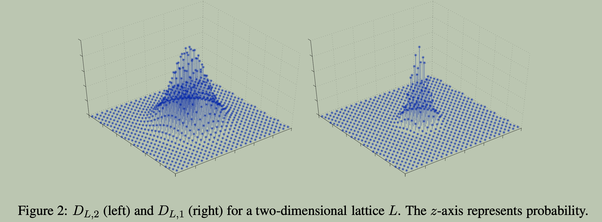

The **discrete Gaussian distribution**  $D_{\mathcal{L}, r}(x)$ is defined over a lattice $\mathcal{L}$ with parameter $r$ such that the probability of sampling a lattice vector $x \in \mathcal{L}$ is proportional to its weight
$$
    w(x) = e^{-\pi \|x\|^2 / r^2}
$$
where $r$ is the Gaussian parameter, ensures that vectors closer to the origin are more likely to be chosen, which is crucial for many lattice-based cryptographic constructions.

We see that :
- smaller length of vector $x$ is more likely to be sampled.
- smaller parameter $r$ means the distribution is more concentrated around the origin, making shorter vectors more likely to be sampled.

 

## Iteration of Discrete Gaussian Sampling

Given :

1. A lattice $\mathcal{L}(B)$ defined by a basis $B$, and its dual lattice $\mathcal{L}^*(B^{-T})$. They satisfy :
   $$
       \langle x, y \rangle \in \mathbb{Z} \quad \forall x \in \mathcal{L}(B), y \in \mathcal{L}^*(B^{-T}).
   $$

2. Discrete Gaussian distribution $D_{\mathcal{L}, r}(x)$ with parameter $r$ over the lattice $\mathcal{L}(B)$, which defines the probability of sampling each lattice vector $x \in \mathcal{L}(B)$ proportional to its weight 
     $$ 
     w(x) = e^{-\pi \|x\|^2 / r^2}.
     $$
    By this distribution, we sample a lattice vector 
    $$
        v \leftarrow D_{\mathcal{L}, r}(x)
    $$

3. Target $y \in \mathbb{R}^n$, which is sufficiently close to the dual lattice $\mathcal{L}^*(B^{-T})$.

4. An LWE oracle $\mathcal{O}$.

We aim to find the closest lattice vector $x \in \mathcal{L}^*$ to the target vector $y$, leveraging the discrete Gaussian samples and the LWE oracle $\mathcal{O}$.

 

### Construct LWE Instance

Firstly, We will focus on how to construct a valid LWE instance from the discrete Gaussian samples and the target vector $y$ :

1. Sample a lattice vector $v$ from the **discrete Gaussian distribution** over the lattice $\mathcal{L}(B)$ with width parameter $r$:
    $$
    v \leftarrow D_{\mathcal{L}, r}(x)
    $$

2. Recover the modularized scalar vector $a = u \pmod q$ from $v$ : 
    $$
    a = B^{-1} v \pmod q
    $$
    , it serves as the LWE instance's public vector component.

3. Sample a noise $g \in \mathbb{R}$ from the **continuous Gaussian distribution** with $0$ mean and standard deviation $\frac{\alpha}{2\sqrt{\pi}}$ :
    $$
        g \leftarrow \mathcal{D}(0, \frac{\alpha}{2\sqrt{\pi}})
    $$

4. Compute the LWE response $b$ using the target vector $y$, the discrete Gaussian sample $v$, and the noise $g$:
    $$
    b = \langle y, v \rangle / q + g \pmod 1
    $$

    

    
 
    Explanation of the response vector 
    

    Since $y = x + h$ where $x$ is the closest lattice vector to $y$ in $\mathcal{L}^*$ and $h$ is the displacement between $x$ and $y$, we have :
    $$
    \begin{aligned}
    b &= \langle y, v \rangle / q + g \pmod 1 \\
    &= \langle x + h, v \rangle / q + g \pmod 1 \\
    &= \langle x, v \rangle / q + \langle h, v \rangle / q + g \pmod 1
    \end{aligned}
    $$
    Since $x \in \mathcal{L}^*$ and $v \in \mathcal{L}$, where $x = B^{-T} c, s = c \pmod q$ for some $c \in \mathbb{Z}^n$ and $v = B u, a = u \pmod q$ for some $u \in \mathbb{Z}^n$, we have  
    $$
    \langle x, v \rangle = \langle B^{-T} c, B u \rangle = \langle c, B^{-1} B u \rangle = \langle c, u \rangle \in \mathbb{Z}.
    $$
    We notice that $c$ and $u$ are the scalar vectors of lattice vectors $x$ and $v$ respectively. And since 
    $$
    \langle c, u \rangle \pmod q = \langle s, a \rangle \pmod q
    $$
    , thus 
    $$
    \langle c, u \rangle / q \pmod 1 = \langle s, a \rangle / q \pmod 1
    $$
    Therefore, 
    $$
    b = \langle s, a \rangle /q + \boxed{\langle h, v \rangle / q + g} \pmod 1
    $$
    where $e = \langle h, v \rangle / q + g$ represents the effective noise in the LWE response, it should also comes from a fixed Gaussian distribution which is independent of $v$ we sampled.

    

     

----

The pair $(a, b)$ is an LWE instance with secret $s$ and effective noise $e = \langle h, v \rangle / q + g$, where $a$ is the public vector component and $b$ is the response vector. In order to ensure $(a, b)$ is a valid LWE instance :

-  the public vector component $a$ should be uniformly distributed over $\mathbb{Z}_q^n$, ensuring that it does not leak information about the secret $s$.

-  the effective noise $e$ should follow a Gaussian distribution with appropriate parameters, independent of the sampled vector $v$.

So, how to achive these two requirements anyway?

-----

Regarding the first one, the uniformality of the public vector $a \in \mathbb{Z}_q^n$ is guaranteed by carefully choosing the width parameter $r$ in $D_{L, r}$ :
$$
r \geq q \cdot \eta_\epsilon(\mathcal{L})
$$
That means, if we sample many enough lattice vectors $v$ from $D_{\mathcal{L}, r}$ and reduce them modulo $q$, the resulting vectors $a = B^{-1} v \pmod q$ will be nearly uniformly distributed over $\mathbb{Z}_q^n$. 

 

In general, the coset of vectors $v$ corresponding to a fixed $a$ is given by 
$$
V_a = \{ q \cdot l + B \cdot a \mid l \in \mathcal{L} \}.
$$
So, for any $a \in \mathbb{Z}_q^n$, by its uniformality over $\mathbb{Z}_q^n$, the probability of it being sampled should be :
$$
Pr[a] = Pr[V_a] = \sum_{v \in V_a} Pr[v] = \sum_{l \in \mathcal{L}} Pr[q \cdot \mathcal{l} + B \cdot a] \approx \frac{1}{q^n} 
$$
where each probability term $Pr[q \cdot l + B \cdot a]$ is proportional to the weight assigned by the discrete Gaussian distribution $D_{\mathcal{L}, r}$, i.e., 
$$
Pr[q \cdot l + B \cdot a] \propto \exp\left(-\pi \frac{\|q \cdot l + B \cdot a\|^2}{r^2}\right).
$$
Why $r \ge q \cdot \eta_\epsilon(\mathcal{L})$ ensures the near uniformity of $a$? The intuition is that when $r$ is sufficiently large, the discrete Gaussian distribution $D_{\mathcal{L}, r}$ spreads the probability mass over many lattice points, making the sum over the coset $V_a$ approximately equal for all $a \in \mathbb{Z}_q^n$. Let's take an example to demonstrate the phenomenon.

 Example

Take $\mathcal{L} = \mathbb{Z}$ be the integer lattice with dimension-$1$, and $q = 2$. Then original lattice $\mathcal{L}$ is partitioned into two cosets modulo $2$:
$$
V_0 = \{ 2l \mid l \in \mathbb{Z} \}, \quad V_1 = \{ 2l + 1 \mid l \in \mathbb{Z} \}.
$$
Our goal is ensure $Pr[V_0] \approx Pr[V_1] \approx 1/2$ by properly set the width parameter $r$ in the discrete Gaussian distribution $D_{\mathcal{L}, r}$.

 

The sum of the weights of all lattice points in the coset $V_0$ is given by
$$
w[V_0] = w(0) + w(\pm 2) + w(\pm 4) + \dots 
$$
Similarly, the sum of the weights of all lattice points in the coset $V_1$ is given by
$$
w[V_1] = w(\pm 1) + w(\pm 3) + w(\pm 5) + \dots 
$$
If we take $r = 1/2, 1, 2, 4$, and see what the resulting accumulated weights of $V_0$ and $V_1$ are : 
$$
\begin{array}{c|c|c|c}
r & w[V_0] & w[V_1] & Pr[V_0] \\
\hline
r = 1/2 & \approx 1 & 0.000006975 & 99.9993\% \\
\hline
r = 1 & 1.000007 & 0.086428 & 92.0448\% \\
\hline
r = 2 & 1.086435 & 0.913579 & 54.3214\% \\
\hline
r = 4 & 2.000014 & 1.999986 & 50.00035\% \\
\end{array}
$$
We see that when we take $r = 4 > \eta_\epsilon(\mathcal{L})$ for some sufficiently small $\epsilon$, the probability of $V$ is approximately unform, i.e., $Pr[V_0] \approx Pr[V_1] \approx 1/2$. This demonstrates the intuition that a sufficiently large $r$ spreads the probability mass over many lattice points, making the distribution over the cosets nearly uniform.

 

> [!Note]
> $\eta_\epsilon(\mathcal{L})$ is defined as the smallest positive real number $s$ such that the discrete Gaussian distribution $D_{\mathcal{L}^*, 1/s}$ over the dual lattice $\mathcal{L}^*$ is $\epsilon$-close to the uniform distribution, where $\mathcal{L}^*$ denotes the dual lattice of $\mathcal{L}$, i.e., 
> $$
> \eta_\epsilon(\mathcal{L}) = \sum_{w \in \mathcal{L}^*, w \ne 0} \exp\left(-\pi \|w\|^2 \cdot s^2 \right) \leq \epsilon.
> $$
 
----

Regarding the second requirement, we need to ensure the error term   
$$
e = \frac{\langle h, v \rangle}{q} + g
$$
also comes from a centred discrete Gaussian distribution whose width parameter is appropriately chosen to ensure that : 
1. the resulting error distribution is sufficiently "smooth" and close to uniform modulo $1$. This is crucial for the security of LWE, as it guarantees that the error term does not reveal significant information about the secret vector $h$.
2. it is independent of the sampled vector $v$, ensuring that the error term does not introduce correlations that could compromise the security of the LWE instance.

Actually, the witdeth parameter of the discrete Gaussian distribution should be like 
$$
\beta = \sqrt{(\frac{r \| h\|}{q})^2 + \frac{\alpha^2}{2} }
$$